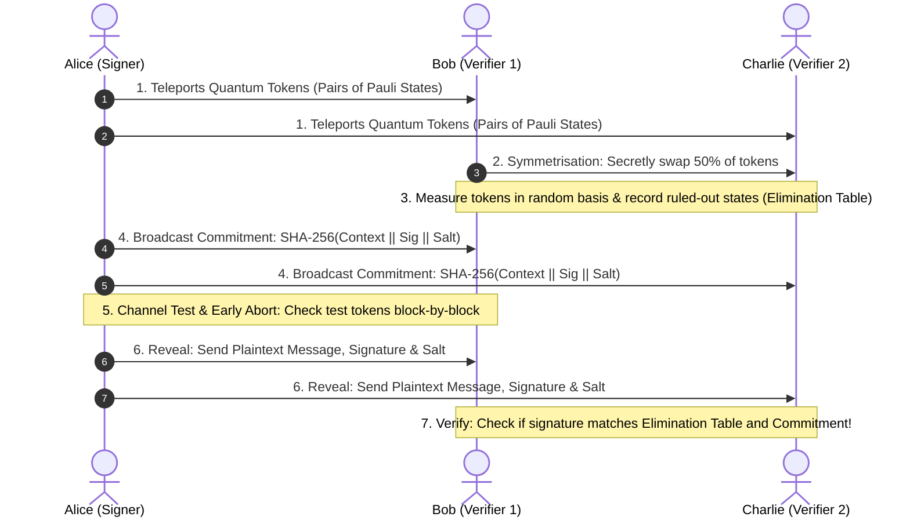
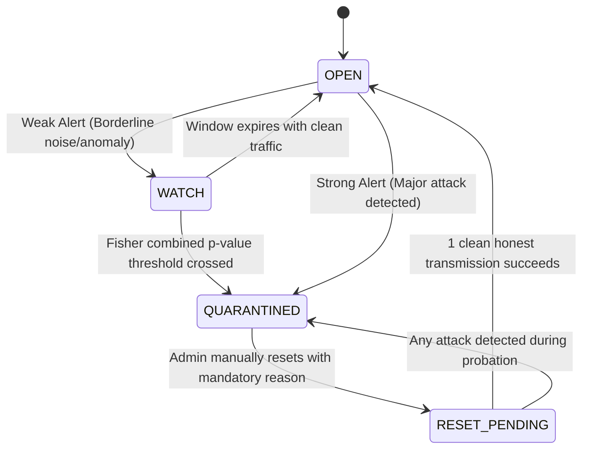

# HEDWIG — Explained For Dummies & Complete Beginners 🦉

Welcome to the beginner-friendly guide for **HEDWIG**! 

If you do not have a background in quantum physics, advanced cryptography, or complex networking, **do not worry**. This document explains every single concept, every folder, and every line of workflow in simple, conversational English using everyday analogies.

> 🔗 **Looking for the technical documentation?** Read [README.md](README.md).

---

## 📑 Table of Contents

1. [What is This Project and Why Does It Exist?](#1-what-is-this-project-and-why-does-it-exist)
2. [The Core Concepts in Plain English (With Everyday Analogies)](#2-the-core-concepts-in-plain-english-with-everyday-analogies)
3. [The Cast of Characters: Alice, Bob, Charlie, and Eve](#3-the-cast-of-characters-alice-bob-charlie-and-eve)
4. [How Does a Quantum Digital Signature Work? (Step-by-Step Story)](#4-how-does-a-quantum-digital-signature-work-step-by-step-story)
5. [Technologies Used & Why We Need Each One](#5-technologies-used--why-we-need-each-one)
6. [Repository Tour: Folder Structure & What Each File Does](#6-repository-tour-folder-structure--what-each-file-does)
7. [Frontend, Backend, Database, and WebSockets: How They Talk](#7-frontend-backend-database-and-websockets-how-they-talk)
8. [The 11 Attacks: How Hackers Attack & How HEDWIG Catches Them](#8-the-11-attacks-how-hackers-attack--how-hedwig-catches-them)
9. [The Quantum Circuit Breaker (QCB): Preventing Link Damage](#9-the-quantum-circuit-breaker-qcb-preventing-link-damage)
10. [Sequential Early Abort: Saving Bandwidth on Attacked Links](#10-sequential-early-abort-saving-bandwidth-on-attacked-links)
11. [Q-Cert: The Post-Quantum Receipts Ledger](#11-q-cert-the-post-quantum-receipts-ledger)
12. [Step-by-Step Installation & Running Guide](#12-step-by-step-installation--running-guide)
13. [Troubleshooting & Common Mistakes](#13-troubleshooting--common-mistakes)
14. [How to Safely Modify Code & Add Features](#14-how-to-safely-modify-code--add-features)
15. [Viva / Demo Cheat Sheet (Common Questions & Winning Answers)](#15-viva--demo-cheat-sheet-common-questions--winning-answers)

---

## 1. What is This Project and Why Does It Exist?

### The Big Problem
Whenever you send an email, authorize a bank wire, or sign an online contract, your computer attaches a **Digital Signature** (like RSA or ECDSA). These traditional signatures rely on mathematical puzzles that are extremely difficult for classical computers to solve (such as factoring gigantic 2048-bit numbers).

However, **Quantum Computers** do not calculate like classical computers. Using quantum physics and algorithms like **Shor's Algorithm**, a future quantum computer can solve those mathematical puzzles in minutes. When large-scale quantum computers arrive, classical digital signatures can be forged by attackers.

### The Solution: Quantum Digital Signatures (QDS)
Instead of relying on math puzzles that might one day be cracked, **Quantum Digital Signatures** derive their security directly from the fundamental laws of nature:
1. **The No-Cloning Theorem:** You cannot make an identical copy of an unknown quantum state. If a hacker tries to copy your signature token, they alter or destroy it.
2. **Heisenberg Uncertainty Principle:** Measuring an unknown quantum particle disturbs it. If an eavesdropper snoops on the transmission line, they leave physical disturbances that are immediately detectable.

### What is HEDWIG?
**HEDWIG** is a **simulation platform** built in Python. Because physical quantum networks and quantum repeaters are still experimental and locked in multi-million-dollar physics labs, HEDWIG simulates the entire quantum and classical protocol inside Python using IBM's Qiskit library and NumPy statevectors.

It provides a full real-time web application where you can:
- Watch Alice sign messages using quantum Pauli tokens.
- Teleport states over simulated fiber links with realistic noise (damping, loss, readout errors).
- Inject 11 cyber attacks (eavesdropping, cloning, tampering, dishonest verifiers, replay).
- Watch a **Quantum Circuit Breaker** isolate compromised links automatically.
- Save and verify tamper-evident receipts signed with **Ed25519** and NIST Post-Quantum **ML-DSA-65 (Dilithium)**.

---

## 2. The Core Concepts in Plain English (With Everyday Analogies)

### Analogy 1: The Magic Polaroid (Quantum Teleportation)
- **Classical Sending:** Imagine mailing a physical letter. A postal worker can open the envelope, photocopy the letter, reseal it, and deliver it. You would never know.
- **Quantum Teleportation:** Alice and Bob each hold one coin from an entangled pair (a Bell pair). Alice takes her secret note, interacts it with her coin, and phones Bob saying: *"Flip your coin twice."* Instantly, Bob's coin takes on the exact secret state of Alice's note, while Alice's original state is destroyed! The quantum state was never sent across the empty space between them; only classical instructions were transmitted.

### Analogy 2: The Elimination Game (Orthogonal Elimination)
In classical signatures, you verify by checking whether a key fits a lock. In HEDWIG's QDS, verification works through **Elimination**:
- Suppose Alice sends Bob a quantum token that is one of four states: $|0\rangle, |1\rangle, |+\rangle, |-\rangle$.
- Bob measures it in a basis of his choice (say, the $Z$-basis).
- If Bob gets outcome $|0\rangle$, quantum mechanics guarantees that Alice's token was **definitely not $|1\rangle$** (its orthogonal opposite).
- Bob writes in his private record: `Eliminated: |1>`.
- When Alice later reveals her signature claiming she sent $|1\rangle$, Bob checks his table, sees that $|1\rangle$ was physically ruled out, and rejects the signature as a fake!

### Analogy 3: The Electrical Fuse (The Quantum Circuit Breaker)
If a wire shorts out in your kitchen, you do not want the entire house to burn down. A circuit breaker trips immediately, shutting off power to that room while keeping the rest of the house safe.
In HEDWIG, if a quantum line shows signs of eavesdropping or tampering, the **Quantum Circuit Breaker (QCB)** trips and **quarantines** the link so attackers cannot harvest quantum information.

---

## 3. The Cast of Characters: Alice, Bob, Charlie, and Eve

In cryptography and HEDWIG, four roles exist:
- **Alice (Signer / Admin):** Prepares the quantum tokens, sends the commitment, and signs the document. She controls the Admin console (`/admin`).
- **Bob (Verifier 1):** Receives quantum tokens, swaps half of them with Charlie, measures them, and verifies Alice's signature. He operates the Bob console (`/bob`).
- **Charlie (Verifier 2):** Another verifier who also receives and swaps tokens. He checks Alice's signature independently and cross-checks with Bob (`/charlie`).
- **Eve (The Attacker / Eavesdropper):** The adversary who sits in the middle. She tries to eavesdrop on the quantum line, clone tokens, forge signatures, or replay old messages.

---

## 4. How Does a Quantum Digital Signature Work? (Step-by-Step Story)



1. **Step 1: Token Distribution via Teleportation**  
   Alice generates pairs of random quantum Pauli states ($\{|0\rangle, |1\rangle, |+\rangle, |-\rangle\}$) for each bit of the signature. She teleports them using Bell pairs ($|\Phi^+\rangle$) to Bob and Charlie.
2. **Step 2: Symmetrisation (Keep-or-Forward Swap)**  
   If Alice is dishonest, she might try to cheat by sending a good signature to Bob and a bad one to Charlie. To prevent this, Bob and Charlie secretly flip coins and swap half of their received tokens. Now Alice cannot know who holds which token!
3. **Step 3: Random Measurement & Elimination**  
   Bob and Charlie randomly measure each qubit in either the $Z$-basis ($\{|0\rangle, |1\rangle\}$) or $X$-basis ($\{|+\rangle, |-\rangle\}$). The result allows them to eliminate an orthogonal candidate from their verification table.
4. **Step 4: The Commitment (The Tamper-Proof Envelope)**  
   Before revealing the signature, Alice computes a SHA-256 hash of the message, signature, timestamp, nonce, and a random salt, and sends this commitment to Bob and Charlie. She cannot alter the message or signature later without breaking the hash.
5. **Step 5: Channel Test & Sequential Early Abort**  
   Alice reveals the identities of interleaved secret **test tokens**. If the error rate (QBER) exceeds the allowable threshold, the link aborts immediately before the signature is ever opened!
6. **Step 6: Reveal & Verification**  
   If the channel test passes, Alice reveals the message, signature, and salt. Bob and Charlie check the commitment hash and verify that Alice's claimed states do not conflict with their private Elimination Tables.

---

## 5. Technologies Used & Why We Need Each One

| Technology | What It Does | Why HEDWIG Needs It |
| :--- | :--- | :--- |
| **Python 3.11+** | Primary programming language | Clean syntax, fast development, rich quantum and scientific packages. |
| **Qiskit & Qiskit-Aer** | Quantum simulation framework | Creates quantum circuits, simulates Bell pairs, Pauli gates, and realistic noise models. |
| **NumPy** | High-performance matrix mathematics | Performs fast statevector operations, random sampling, and statistical calculations. |
| **FastAPI** | Modern web framework | Serves the web dashboard, manages REST APIs, and enforces role-based authentication. |
| **WebSockets** | Real-time bi-directional messaging | Pushes real-time quantum telemetry and circuit breaker alerts to Alice, Bob, and Charlie without page reloads. |
| **SQLite 3** | Lightweight relational database | Stores transmission logs, circuit breaker state transitions, and audit chains in `data/hedwig.db`. |
| **Cryptography (Ed25519)** | Classical public-key signature library | Signs audit records and certificates with fast, established digital signatures. |
| **dilithium-py (ML-DSA-65)** | NIST Post-Quantum signature standard | Dual-signs audit records so receipts remain secure even against future quantum computers. |
| **Vanilla HTML/CSS/JS** | Web frontend interface | Clean, responsive dark-mode cyber console with zero heavy external node/npm build dependencies. |

---

## 6. Repository Tour: Folder Structure & What Each File Does

```text
sih 2026/
│
├── server.py              # Main web server: FastAPI routes, WebSocket manager, API handlers.
├── auth.py                # Security manager: PBKDF2 hashing, role sessions, cookie verification.
├── users.json             # Stored credentials file with PBKDF2 password hashes and salts.
├── requirements.txt       # Production dependencies (FastAPI, Qiskit, cryptography, etc.).
├── requirements-pq.txt    # Optional Post-Quantum dependencies (dilithium-py for ML-DSA-65).
├── requirements-dev.txt   # Development dependencies (pytest, matplotlib).
├── run_v2.bat             # Windows one-click batch launcher.
├── run_experiments.py     # Reproducible experiment runner & manifest generator.
│
├── templates/             # Jinja2 HTML templates:
│   ├── login.html         # Login interface with role selector.
│   ├── admin.html         # Alice's mission control dashboard & attack injector.
│   ├── bob.html           # Bob's verifier terminal & dishonest forwarding trigger.
│   └── charlie.html       # Charlie's verifier terminal & cross-check audit display.
│
├── static/                # Static assets:
│   ├── css/style.css      # Dark-mode styling, glassmorphism, responsive tiles.
│   ├── js/app.js          # JavaScript WebSocket client & dynamic DOM updates.
│   └── img/icons.svg      # Vector icons.
│
├── src/quantum_engine/    # CORE PROTOCOL LOGIC:
│   ├── protocol.py        # Master orchestrator: TeleportationQDS main execution pipeline.
│   ├── teleportation.py   # Qiskit Bell-pair circuits, state preparation, feed-forward.
│   ├── symmetrisation.py  # Keep-or-forward token swapping between Bob and Charlie.
│   ├── elimination.py     # Orthogonal state measurement & elimination table tracking.
│   ├── channel.py         # Quantum noise channels (depolarizing, readout, loss, damping).
│   ├── threats.py         # Attack suite: 11 simulated attack injectors.
│   ├── detection.py       # Blind threat detector: classifies attacks without labels.
│   ├── discriminator.py   # Tier 2 attribution: distinguishes channel noise from repudiation.
│   ├── policy.py          # Response policy & Fisher's combined p-value escalation.
│   ├── enforcement.py     # Quantum Circuit Breaker (OPEN, WATCH, QUARANTINED, RESET_PENDING).
│   ├── binding.py         # SignedContext & cryptographic commitment validation.
│   ├── verifier.py        # VerifierNode & Hoeffding/exact binomial acceptance checks.
│   ├── cloning.py         # Quantum cloning machine models (Universal & Phase-covariant).
│   ├── audit.py           # Q-Cert ledger, hash chains, and certificate generator.
│   ├── signers.py         # Ed25519 and ML-DSA-65 signature implementation.
│   ├── store.py           # SQLite database persistence layer.
│   ├── thresholds.py      # Exact binomial limits & reserve stage planning.
│   └── security.py        # Theoretical security bounds and parameter calculations.
│
├── tests/                 # Automated test suite (24 test modules covering all features).
└── experiments/           # Benchmark scripts, noise sweeps, ROC curves, and ablations.
```

---

## 7. Frontend, Backend, Database, and WebSockets: How They Talk

1. **User Action:** You open `http://localhost:8000/admin`, type a message like *"Transfer $1,000"*, select `eve_intercept`, and click **Sign & Send**.
2. **Frontend Request:** The browser sends an authenticated `POST /api/sign-and-send` JSON request to `server.py`.
3. **Backend Processing:**
   - `server.py` verifies your session cookie (`hedwig_admin`).
   - It invokes `qds_engine.execute_protocol()` in [src/quantum_engine/protocol.py](file:///e:/2026-2/sih%202026/src/quantum_engine/protocol.py).
   - [teleportation.py](file:///e:/2026-2/sih%202026/src/quantum_engine/teleportation.py) prepares Bell pairs and teleports tokens.
   - [threats.py](file:///e:/2026-2/sih%202026/src/quantum_engine/threats.py) simulates Eve measuring qubits mid-flight.
   - [detection.py](file:///e:/2026-2/sih%202026/src/quantum_engine/detection.py) detects high QBER on the test tokens.
   - [enforcement.py](file:///e:/2026-2/sih%202026/src/quantum_engine/enforcement.py) trips the Quantum Circuit Breaker to `QUARANTINED`.
   - [audit.py](file:///e:/2026-2/sih%202026/src/quantum_engine/audit.py) writes a new block to the hash chain and dual-signs it.
   - [store.py](file:///e:/2026-2/sih%202026/src/quantum_engine/store.py) commits the record to `data/hedwig.db`.
4. **WebSocket Broadcast:** `server.py` broadcasts the transmission result to all active WebSocket listeners (`/ws/admin`, `/ws/bob`, `/ws/charlie`).
5. **Frontend Update:** Without reloading the page, Alice's console turns red with a quarantine warning, Bob's dashboard shows the attack report, and the audit log adds the new certificate!

---

## 8. The 11 Attacks: How Hackers Attack & How HEDWIG Catches Them

| Attack Name | What the Hacker Does | Everyday Analogy | How HEDWIG Catches It |
| :--- | :--- | :--- | :--- |
| **1. Authentic** | Normal honest transmission. | Sending a certified letter via secure courier. | Accepted! Channel noise is within the statistical limit. |
| **2. Eve Forgery** | Eve generates random fake tokens without Alice's keys. | A burglar trying to guess a key shape out of tin foil. | Contradicts Bob and Charlie's elimination tables (~25% error rate). Link quarantined. |
| **3. Dishonest Bob** | Bob alters the signature and forwards it to Charlie. | An accountant altering a company check before passing it to the bank. | Fails Charlie's forwarded elimination threshold ($s_v$). Forward link quarantined. |
| **4. Eve Intercept** | Eve intercepts qubits, measures them, and resends new ones. | A spy opening envelopes, photocopying letters, and resealing them. | Quantum measurement collapses states, causing ~25% QBER on test tokens. Link quarantined. |
| **5. Message Tampering** | Eve changes the plaintext message text ($100 $\to$ $10,000). | Altering the amount written on a signed check. | SHA-256 commitment hash fails! Message rejected; quantum link stays OPEN (prevents DoS). |
| **6. Repudiation** | Alice signs, but later claims: *"I never signed that!"* | A buyer signing a receipt, then claiming their signature was forged. | Tier 2 proves the channel was clean, meaning Alice intentionally revealed conflicting bits! |
| **7. Replay Attack** | Eve captures yesterday's valid transmission and sends it again. | Trying to enter a concert using yesterday's ticket stub. | The session nonce was already used or the timestamp expired. Rejected immediately. |
| **8. Impersonation** | Someone claims to be Alice without having shared distribution records. | Showing up wearing a fake employee badge. | No pre-shared distribution record exists for that session ID. Rejected. |
| **9. Eve Loss Exploit** | Eve intercepts tokens and drops any that she disturbs. | A thief who steals letters and burns any with ink smudges. | Loss rate monitor detects an abnormal drop in received tokens. |
| **10. Eve Cloning** | Eve passes qubits through a theoretical Quantum Cloning Machine. | Trying to duplicate a high-security watermark on a home copier. | The No-Cloning Theorem limits cloner fidelity ($\le 83.33\%$). Caught by fidelity bounds! |
| **11. Partial Intercept** | Eve only intercepts 5% of tokens to try to fly under the radar. | A spy inspecting only 1 out of every 20 letters. | **Sequential Early Abort** catches the cumulative errors across blocks and escalates to quarantine. |

---

## 9. The Quantum Circuit Breaker (QCB): Preventing Link Damage

The **Quantum Circuit Breaker** protects quantum links just like an electrical fuse:



- **OPEN:** The link is healthy. Normal quantum transmissions proceed.
- **WATCH:** A borderline statistical anomaly was observed. Traffic continues, but the test-token budget is increased to monitor the link closely.
- **QUARANTINED:** A confirmed attack occurred! The circuit breaker immediately blocks all new transmissions (returning HTTP 423 Locked) to protect sensitive quantum keys.
- **RESET_PENDING (Probation):** An administrator cleared the quarantine with a logged reason. The link is on probation: one successful honest transmission restores it to `OPEN`, but any disturbance instantly re-quarantines it.

---

## 10. Sequential Early Abort: Saving Bandwidth on Attacked Links

In standard protocols, if an attacker tampers with a transmission, the entire quantum stream is sent before anyone checks the error rate. 

HEDWIG features **Sequential Early Abort**:
- Tokens are transmitted in sequential blocks.
- After each block, the running error count on secret test tokens is evaluated against a binomial threshold.
- If the error rate decisively proves an attack is taking place, transmission **halts immediately**.
- **Benefit:** For high-intensity eavesdropping (like `eve_intercept`), up to **40–60% of quantum bandwidth is saved**, preventing unnecessary consumption of Bell pairs!

---

## 11. Q-Cert: The Post-Quantum Receipts Ledger

Every time a transmission is evaluated, a link is quarantined, or an administrator resets a circuit breaker, HEDWIG generates a **Q-Cert Certificate**:
1. **Structured Record:** Encodes the transmission ID, timestamps, error rates, and security verdict into canonical JSON.
2. **SHA-256 Hash Chain:** Each certificate includes the SHA-256 hash of the previous certificate, forming an append-only, tamper-evident hash chain.
3. **Dual Signing (Hybrid Cryptography):**
   - **Ed25519:** Industry-standard classical signature for immediate validation.
   - **ML-DSA-65 (Dilithium):** NIST FIPS 204 Post-Quantum signature secure against quantum computer attacks.
4. **Independent Verification:** Anyone can download any certificate (`/api/audit/{id}`) and verify its validity offline using the public keys.

---

## 12. Step-by-Step Installation & Running Guide

### Step 1: Verify Python Installation
Make sure you have Python 3.11 or higher installed:
```bash
python --version
```

### Step 2: Open Terminal in Project Directory
```bash
cd "e:\2026-2\sih 2026"
```

### Step 3: Create and Activate Virtual Environment
- **Windows (PowerShell):**
  ```powershell
  python -m venv .venv
  .\.venv\Scripts\Activate.ps1
  ```
- **Linux / macOS:**
  ```bash
  python3 -m venv .venv
  source .venv/bin/activate
  ```

### Step 4: Install Dependencies
```bash
pip install -r requirements.txt
pip install -r requirements-pq.txt
pip install -r requirements-dev.txt
```

### Step 5: Start the Server
```bash
python server.py
```
*(On Windows, you can also simply double-click `run_v2.bat`!)*

### Step 6: Access the Web Consoles
Open your browser to:
- **`http://localhost:8000/login`**
- Log in as **Alice / Admin**: `admin` / `admin2026` (or `alice` / `quantum2026`)
- In an Incognito window or another browser, log in as **Bob**: `bob` / `quantum2026`
- In a third window, log in as **Charlie**: `charlie` / `quantum2026`

---

## 13. Troubleshooting & Common Mistakes

- **Issue: `HTTP 423 Locked: Link is quarantined`**
  - *Cause:* You ran an attack scenario, and the Quantum Circuit Breaker tripped to protect the system.
  - *Fix:* In the Admin console (`/admin`), scroll down to the **Quantum Circuit Breaker** section, enter a reason (e.g., *"Clearing lab demonstration"*), and click **Reset Link**. Then run an **Authentic** transmission to complete probation.
- **Issue: `ModuleNotFoundError: No module named 'fastapi'`**
  - *Cause:* The virtual environment is not activated in your current terminal.
  - *Fix:* Run `.\.venv\Scripts\Activate.ps1` (or `source .venv/bin/activate`) before running python commands.
- **Notice: `HEDWIG_USERS_FILE not set: using built-in DEMO credentials`**
  - *Explanation:* This is standard behavior in demo mode. The platform uses built-in credentials (`admin2026` / `quantum2026`).
- **How to start with a fresh database?**
  - Stop the server (`Ctrl + C`) and delete `data/hedwig.db`. The server will automatically recreate a fresh database upon startup.

---

## 14. How to Safely Modify Code & Add Features

When adding features or modifying code in HEDWIG, follow these guidelines:
1. **Run automated tests first:**
   ```bash
   pytest -q
   ```
   Ensure tests pass before making edits.
2. **Make new behavior opt-in:** Use parameters or environment variables so existing tests and demo workflows continue to function without interruption.
3. **Always use fixed seeds:** For any new quantum simulation or statistical test, supply a random seed (e.g., `seed=2026`) to ensure reproducible results.
4. **Preserve simulation integrity:** Never claim physical quantum hardware results; this is a software simulation.

---

## 15. Viva / Demo Cheat Sheet (Common Questions & Winning Answers)

### Q1: Is this running on physical quantum hardware?
> **Answer:** *"No. HEDWIG is a high-fidelity classical simulation using Qiskit Aer and NumPy statevectors executing on classical CPUs. Physical quantum repeaters and distributed quantum internet hardware are not yet commercially deployed. Our platform mathematically simulates the Bell states, noisy quantum channels, and Pauli measurements to validate the protocol, threat detection, and circuit breaker behavior."*

### Q2: Why use Quantum Teleportation instead of directly transmitting qubits through optical fiber?
> **Answer:** *"Direct transmission of single photons suffers from exponential loss over long optical fibers (>100 km). Quantum Teleportation uses pre-shared entangled Bell pairs and classical communications. Once entanglement is distributed across repeaters, state transfer can achieve near-perfect fidelity without having the physical signature qubit traverse the lossy fiber."*

### Q3: How does the system catch an attacker who only intercepts 5% of tokens?
> **Answer:** *"Through two complementary mechanisms: First, our Sequential Early Abort monitors error rates across sequential token blocks; second, our Response Policy applies Fisher's combined p-value method to accumulate weak statistical anomalies over time. Even if individual test windows look borderline, the combined probability rapidly crosses our quarantine threshold."*

### Q4: Why doesn't a Message Tampering attack trip the Quantum Circuit Breaker?
> **Answer:** *"Because Message Tampering is an attack on the classical message text, not eavesdropping on the physical quantum channel. If tampering tripped the quantum circuit breaker, any remote attacker could cause a Denial of Service by sending bad text over the internet. HEDWIG rejects the tampered message based on the SHA-256 commitment but keeps the quantum channel open."*

### Q5: What makes your audit ledger 'Post-Quantum'?
> **Answer:** *"Every audit certificate is linked in a SHA-256 hash chain and dual-signed using both classical Ed25519 and NIST FIPS 204 ML-DSA-65 (Dilithium). Even if an adversary captures the ledger and cracks classical cryptography using a quantum computer years from now, the ML-DSA-65 signature remains computationally unbreakable."*

---

*HEDWIG V2.2 — Developed by Team ATHENA for SIH 2026.*  
*Back to Technical Documentation: [README.md](README.md)*
