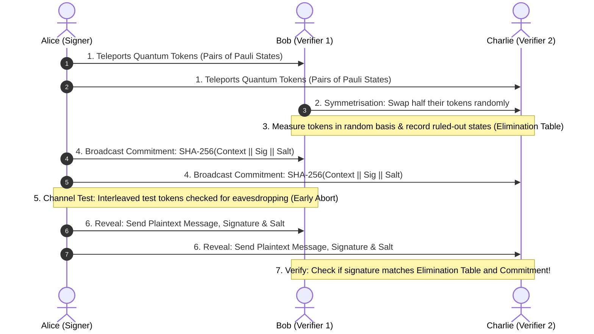
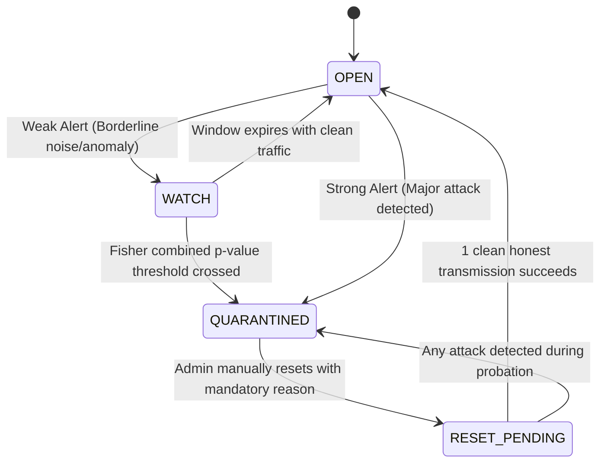

# HEDWIG — Explained For Dummies & Complete Beginners 🦉

Welcome to the beginner-friendly guide for **HEDWIG**! 

If you don't have a background in quantum physics, advanced cryptography, or complex networking, **don't worry**. This document explains every single concept, every folder, and every line of workflow in simple, conversational English using everyday analogies.

> 🔗 **Looking for the technical documentation?** Read [README.md](README.md).

---

## 📑 Table of Contents

1. [What is This Project and Why Does It Exist?](#1-what-is-this-project-and-why-does-it-exist)
2. [The Core Concepts in Plain English (With Analogies)](#2-the-core-concepts-in-plain-english-with-analogies)
3. [The Three Characters: Alice, Bob, and Charlie](#3-the-three-characters-alice-bob-and-charlie)
4. [How Does a Digital Signature Work Here? (5-Step Story)](#4-how-does-a-digital-signature-work-here-5-step-story)
5. [Technologies Used & Why We Need Them](#5-technologies-used--why-we-need-them)
6. [Folder Structure & What Each File Actually Does](#6-folder-structure--what-each-file-actually-does)
7. [Frontend, Backend, Database, and WebSockets: How They Talk](#7-frontend-backend-database-and-websockets-how-they-talk)
8. [The 11 Attacks: How Hackers Try to Break It & How HEDWIG Catches Them](#8-the-11-attacks-how-hackers-try-to-break-it--how-hedwig-catches-them)
9. [The Quantum Circuit Breaker (QCB): Stopping Link Damage](#9-the-quantum-circuit-breaker-qcb-stopping-link-damage)
10. [Q-Cert: The Post-Quantum Receipts Ledger](#10-q-cert-the-post-quantum-receipts-ledger)
11. [Step-by-Step Installation & Running Guide](#11-step-by-step-installation--running-guide)
12. [Troubleshooting & Common Mistakes](#12-troubleshooting--common-mistakes)
13. [How to Safely Modify Code](#13-how-to-safely-modify-code)
14. [Viva / Demo Cheat Sheet (Common Questions & Winning Answers)](#14-viva--demo-cheat-sheet-common-questions--winning-answers)

---

## 1. What is This Project and Why Does It Exist?

### The Big Problem
Whenever you send an email, buy something on Amazon, or sign an online document, your computer uses a **Digital Signature** (like RSA or ECC). These signatures depend on math puzzles that are hard for regular computers to solve, like factoring massive numbers.

However, **Quantum Computers** use quantum mechanics and algorithms (like Shor's algorithm) that can crack these math puzzles in minutes. When quantum computers arrive, all standard digital signatures could be forged!

### The Solution: Quantum Digital Signatures (QDS)
Instead of relying on math puzzles, **Quantum Digital Signatures** rely on the **fundamental laws of nature**:
1. **The No-Cloning Theorem:** You cannot make an identical copy of an unknown quantum particle. If a hacker tries to copy your signature token, they destroy or alter it.
2. **Measurement Disturbance (Heisenberg):** If a hacker eavesdrops and looks at the quantum particle on the wire, the particle changes state! We will immediately notice the disturbance.

### What is HEDWIG?
**HEDWIG** is a **simulation platform** built in Python. Because physical quantum computers with quantum internet cables are still locked in multimillion-dollar research labs, HEDWIG simulates the entire process inside Python using IBM's Qiskit library. 

It lets you see, in real-time on a modern web dashboard:
- Alice signing a message.
- Quantum tokens being "teleported" over noisy lines to Bob and Charlie.
- Hackers trying to forge, tamper, eavesdrop, or clone tokens.
- An intelligent **Circuit Breaker** cutting off corrupted cables before damage spreads.
- An immutable **Audit Ledger** recording everything with Post-Quantum cryptography.

---

## 2. The Core Concepts in Plain English (With Analogies)

### Analogy 1: The Magic Polaroid (Quantum Teleportation)
- **Classical Sending:** Throwing a letter through the air. A thief can grab it, read it, copy it with a scanner, and throw it onward.
- **Quantum Teleportation:** Alice and Bob share a pair of "magically entangled coins" (Bell pairs). Alice takes her secret note, touches her coin, and calls Bob on the phone to say: *"Flip your coin twice."* Instantly, Bob's coin transforms into the exact state of Alice's note, while Alice's note is erased! The secret never traveled across the empty space; only classical instructions did.

### Analogy 2: The Two-Way Lockbox (Orthogonal Elimination)
In regular signatures, you verify by checking if a key matches a lock. In HEDWIG's QDS, we use **Elimination**:
- Suppose Alice sends an apple that is either **Red**, **Green**, **Sweet**, or **Sour**.
- Bob tests it with a light filter. Bob's test doesn't tell him exactly what Alice sent, but it proves with 100% certainty: *"It is definitely NOT Sour."*
- Bob writes in his table: `Ruled out: Sour`.
- When Alice later reveals what she signed, she claims: *"I sent you Sour!"*
- Bob immediately says: *"LIAR! My quantum test already eliminated Sour!"*

### Analogy 3: The Electrical Fuse (Quantum Circuit Breaker)
If your toaster shorts out in your kitchen, you don't want your house to burn down. A circuit breaker trips and cuts the electricity to that specific room.
In HEDWIG, if a quantum link between Alice and Bob shows signs of an eavesdropper, the **Quantum Circuit Breaker (QCB)** trips and **quarantines** the link so no more messages can be stolen.

---

## 3. The Three Characters: Alice, Bob, and Charlie

In cryptography, we always use standard character names:
- **Alice (The Signer / Admin):** Wants to sign an important message (like *"Transfer $10,000"*). She prepares the quantum tokens and controls the transmission.
- **Bob (Verifier 1):** Receives tokens, swaps some with Charlie, eliminates states, and decides whether Alice's signature is genuine.
- **Charlie (Verifier 2):** Another verifier who also checks the signature independently. Bob and Charlie cross-verify to ensure Alice didn't cheat one of them.
- **Eve (The Adversary / Hacker):** Sits in the middle. She tries to eavesdrop on the quantum channel, forge signatures, alter messages, or replay old messages.

---

## 4. How Does a Digital Signature Work Here? (5-Step Story)



1. **Step 1: Quantum Token Preparation & Teleportation**
   Alice takes the message length (e.g. 32 bits). For each bit, she creates quantum tokens in Pauli states ($|0\rangle, |1\rangle, |+\rangle, |-\rangle$). She teleports them using Bell pairs to Bob and Charlie.
2. **Step 2: Symmetrisation (Keep-or-Forward Swap)**
   Alice might be evil and try to give Bob a valid signature but give Charlie garbage. To stop this, Bob and Charlie secretly flip coins and swap half their received tokens with each other. Now, Alice has no idea who holds which token!
3. **Step 3: Random Measurement & Elimination**
   Bob and Charlie randomly choose to measure each qubit in either the $Z$-basis ($\{|0\rangle, |1\rangle\}$) or $X$-basis ($\{|+\rangle, |-\rangle\}$). This measurement rules out one orthogonal state and forms their secret **Elimination Table**.
4. **Step 4: The Commitment (The Sealed Envelope)**
   Before revealing the signature, Alice locks her signature inside a digital safe using SHA-256 hashing. She announces: *"Here is the hash of my signature, my message, a unique nonce, and a secret salt."* She cannot change her mind later.
5. **Step 5: Reveal & Independent Verification**
   Alice reveals the plaintext and the salt. Bob and Charlie check:
   - Does the opened envelope match the hash from Step 4?
   - Does Alice's signature contradict any ruled-out states in their Elimination Table?
   - If mismatches are low (within honest noise limits), they ACCEPT. If not, they REJECT and sound the alarm!

---

## 5. Technologies Used & Why We Need Them

| Technology | What it is | Why HEDWIG needs it |
| :--- | :--- | :--- |
| **Python 3.11+** | The programming language | Simple to write, huge scientific and quantum ecosystem. |
| **Qiskit & Qiskit-Aer** | IBM's quantum computing library | Simulates quantum circuits, Bell pairs, Pauli gates, and quantum measurements on your CPU. |
| **NumPy** | High-performance matrix math library | Handles fast statevector math and random sampling for fast simulations. |
| **FastAPI** | Modern, high-performance web framework | Serves the web dashboard, processes REST API requests, and handles authentication. |
| **WebSockets** | Real-time bi-directional connection | Pushes live quantum telemetry and alert popups to Alice, Bob, and Charlie's screens instantly without refreshing the page. |
| **SQLite 3** | Lightweight file-based SQL database | Saves transmission records, circuit breaker logs, and audit chains in `data/hedwig.db`. |
| **Cryptography (Ed25519)** | High-speed classical digital signatures | Signs audit records so no one can secretly tamper with the historical logs. |
| **dilithium-py (ML-DSA-65)** | NIST-standard Post-Quantum Signature | Dual-signs audit certificates so even a future quantum computer cannot forge the audit receipts. |
| **Vanilla HTML/CSS/JS** | Web frontend | Creates a sleek, responsive dark-mode cyber console with zero heavy node.js dependencies. |

---

## 6. Folder Structure & What Each File Actually Does

```text
e:\2026-2\sih 2026\
│
├── server.py              # The Main Web Server: Runs FastAPI, routes APIs, and manages WebSockets.
├── auth.py                # Security Bouncer: Checks passwords, creates sessions, and sets cookies.
├── users.json             # User Database: Holds PBKDF2 hashed passwords for admin, bob, and charlie.
├── requirements.txt       # Shopping List: Python libraries required to run HEDWIG.
├── requirements-pq.txt    # Optional Post-Quantum Library: Adds dilithium-py for ML-DSA-65 signing.
├── run_v2.bat             # Quick Starter: Batch script to start the server on Windows with one double-click.
│
├── templates/             # HTML Web Pages (Jinja2):
│   ├── login.html         # Login screen.
│   ├── admin.html         # Alice's mission control dashboard.
│   ├── bob.html           # Bob's verifier terminal.
│   └── charlie.html       # Charlie's verifier terminal.
│
├── static/                # Visual styling & Javascript:
│   ├── css/style.css      # Dark-mode styling, glassmorphism, buttons, and telemetry tiles.
│   ├── js/app.js          # JavaScript that listens to WebSockets and updates graphs dynamically.
│   └── img/icons.svg      # Vector icons for the interface.
│
├── src/quantum_engine/    # THE BRAIN: All quantum and security logic lives here:
│   ├── protocol.py        # Master Conductor: Connects Alice, channels, and verifiers together.
│   ├── teleportation.py   # Quantum Teleportation: Builds Qiskit circuits for Bell pairs and feed-forward.
│   ├── symmetrisation.py  # Keep-or-Forward: Swaps tokens between Bob and Charlie.
│   ├── elimination.py     # Elimination Tables: Checks for orthogonal measurement contradictions.
│   ├── channel.py         # Physics Noise: Adds depolarizing noise, damping, loss, and readout errors.
│   ├── threats.py         # Attack Injectors: Simulates 11 hacker attacks (Eve, dishonest Bob, etc.).
│   ├── detection.py       # Detective: Analyzes evidence blindly to detect who is attacking.
│   ├── discriminator.py   # Tier 2 Analysis: Distinguishes between noisy wires and a cheating Alice.
│   ├── policy.py          # Decision Rules: Decides whether to WATCH or QUARANTINE a link.
│   ├── enforcement.py     # Circuit Breaker: Enforces lockouts and tracks probation states.
│   ├── binding.py         # Digital Safe: Creates cryptographic context commitments.
│   ├── verifier.py        # Verifier Node: Bob and Charlie's decision-making logic.
│   ├── cloning.py         # Eve's Cloner: Simulates quantum cloning machines.
│   ├── audit.py           # Receipts Ledger: Manages SHA-256 hash chains and issues Q-Certs.
│   ├── signers.py         # Signature Engines: Handles Ed25519 and ML-DSA-65 keys.
│   └── store.py           # Database Manager: Interacts with the SQLite database.
│
├── tests/                 # Automated Tests: 16 test files ensuring 217 tests pass perfectly.
└── experiments/           # Science Lab: Benchmark scripts for noise sweeps and paper charts.
```

---

## 7. Frontend, Backend, Database, and WebSockets: How They Talk

1. **User Action:** You open `http://localhost:8000/admin`, type a message like *"Pay $500"*, pick an attack like `eve_intercept`, and click **Sign & Teleport**.
2. **Frontend Request:** The browser sends a `POST /api/sign-and-send` JSON request to `server.py`.
3. **Backend Processing:**
   - `server.py` checks that your cookie proves you are `admin` (Alice).
   - It calls `qds_engine.execute_protocol()` in `src/quantum_engine/protocol.py`.
   - `teleportation.py` creates quantum states in Qiskit.
   - `threats.py` injects Eve's interception.
   - `detection.py` and `discriminator.py` spot the eavesdropping.
   - `enforcement.py` trips the Circuit Breaker to `QUARANTINED`.
   - `audit.py` writes a new block to the hash chain and signs it.
   - `store.py` writes the record to `data/hedwig.db`.
4. **WebSocket Broadcast:** `server.py` broadcasts the result over WebSockets to all connected browsers (`/ws/admin`, `/ws/bob`, `/ws/charlie`).
5. **Frontend Update:** Without reloading the page, Alice's console turns red with a quarantine alert, Bob's dashboard shows the attack report, and the audit ledger updates in real time!

---

## 8. The 11 Attacks: How Hackers Try to Break It & How HEDWIG Catches Them

| Attack Name | What the Hacker Does | Real-World Analogy | How HEDWIG Catches It |
| :--- | :--- | :--- | :--- |
| **1. Authentic** | Normal honest transmission. | Sending a certified letter safely. | Accepted! Channel noise is within threshold. |
| **2. Eve Forgery** | Eve creates random fake tokens without Alice's keys. | A thief making a fake key with tin foil. | Bob & Charlie's elimination tables catch contradictions (~25% error rate). Link quarantined. |
| **3. Dishonest Bob** | Bob tries to forge Alice's signature and forward it to Charlie. | An accountant forging the boss's check to trick the bank. | Elimination table fails Charlie's forwarded threshold ($s_v$). Forward link quarantined. |
| **4. Eve Intercept** | Eve measures qubits mid-flight and resends new ones. | A wiretapper tapping a wire, but dropping and replacing items. | Measurements disturb quantum states, causing ~25% QBER in Tier 1 test tokens. Link quarantined. |
| **5. Message Tampering** | Eve changes the plaintext message text (e.g. $100 $\to$ $10,000). | Altering the number on a signed check. | The SHA-256 commitment digest doesn't match! Package rejected, but quantum link stays open (prevents DoS). |
| **6. Repudiation** | Alice sends tokens, but later claims: *"I never signed that!"* | A buyer signing a receipt, then claiming the signature was forged. | Tier 2 proves the channel test was clean, meaning Alice intentionally revealed conflicting bits! |
| **7. Replay Attack** | Eve captures yesterday's valid transmission and sends it again. | Re-using an old movie ticket. | The context nonce has already been seen or the timestamp expired. Rejected immediately. |
| **8. Impersonation** | Someone claims to be Alice without having shared distribution records. | Showing up wearing Alice's nametag. | No pre-shared distribution record exists for that session ID. Rejected. |
| **9. Eve Loss Exploit** | Eve intercepts tokens, and drops any tokens she accidentally disturbs. | A thief intercepting letters and throwing away any with smudged ink. | Loss rate detector flags abnormal token drop counts. |
| **10. Eve Cloning** | Eve passes qubits through a theoretical Quantum Cloning Machine. | Trying to run money through a photocopier. | Quantum No-Cloning theorem limits cloner fidelity ($\le 83.33\%$). Caught by fidelity bounds! |
| **11. Partial Intercept** | Eve only eavesdrops on 5% of tokens to try to fly under the radar. | A spy only opening 1 out of every 20 letters. | **Sequential Early Abort** catches the cumulative errors across blocks and escalates to quarantine. |

---

## 9. The Quantum Circuit Breaker (QCB): Stopping Link Damage

Just like an electrical fuse, the **Quantum Circuit Breaker** has four states:



- **OPEN:** Everything is healthy. Normal traffic flows.
- **WATCH:** A minor statistical anomaly was seen. The link carries traffic, but doubles test tokens to inspect closely.
- **QUARANTINED:** An attack occurred! The circuit breaker refuses all new transmissions (returns HTTP 423 Locked) to protect secrets.
- **RESET_PENDING (Probation):** An administrator cleared the alarm. The link is on probation: one clean send returns it to `OPEN`, but any disturbance instantly quarantines it again!

---

## 10. Q-Cert: The Post-Quantum Receipts Ledger

Whenever a transmission occurs or a circuit breaker trips, HEDWIG writes a **Q-Cert Certificate**:
1. It packages the transmission ID, timestamps, error rates, and security verdict into a JSON object.
2. It hashes the object with **SHA-256** and links it to the previous certificate's hash (forming an **immutable blockchain-style hash chain**).
3. It signs the receipt using **two signatures at the same time (Hybrid Signing)**:
   - **Ed25519:** Fast, rock-solid classical signature.
   - **ML-DSA-65 (Dilithium):** NIST standard Post-Quantum signature immune to quantum cracking!
4. Anyone can download the `.json` certificate and verify it offline using the public keys!

---

## 11. Step-by-Step Installation & Running Guide

### Step 1: Open Terminal / Command Prompt
Make sure you have Python 3.11 installed. Verify by typing:
```bash
python --version
```

### Step 2: Navigate to Project Folder
```bash
cd "e:\2026-2\sih 2026"
```

### Step 3: Create & Activate Virtual Environment
```powershell
python -m venv .venv
.\.venv\Scripts\Activate.ps1
```
*(You will see `(.venv)` appear at the start of your command line.)*

### Step 4: Install Dependencies
```bash
pip install -r requirements.txt
pip install -r requirements-pq.txt
```

### Step 5: Start HEDWIG
```bash
python server.py
```
*(Or simply double-click `run_v2.bat` on Windows!)*

### Step 6: Open the Dashboards
Open your web browser to:
- **`http://localhost:8000/login`**
- Log in with `admin` / `admin2026` to access Alice's Admin Console.
- Open another tab or incognito window for Bob: `bob` / `quantum2026`.
- Open another tab for Charlie: `charlie` / `quantum2026`.

---

## 12. Troubleshooting & Common Mistakes

- **Error: `HTTP 423 Locked: Link is quarantined`**
  - *Cause:* You ran an attack scenario, and the Circuit Breaker did its job and locked the link!
  - *Fix:* In the Admin console (`/admin`), scroll down to the **Quantum Circuit Breaker** section, type a reason (e.g., *"Clearing lab incident"*), and click **Reset Link**. Then send an **Authentic** transmission to complete probation.
- **Error: `ModuleNotFoundError: No module named 'fastapi'`**
  - *Cause:* You forgot to activate your virtual environment.
  - *Fix:* Run `.\.venv\Scripts\Activate.ps1` before starting the server.
- **Warning: `HEDWIG_USERS_FILE not set: using built-in DEMO credentials`**
  - *Cause:* This is normal! HEDWIG defaults to the built-in demo passwords (`quantum2026`).
- **Can I delete the database to start fresh?**
  - *Yes:* Stop the server (`Ctrl + C`) and delete the file `data/hedwig.db`. When you start the server again, it creates a fresh database.

---

## 13. How to Safely Modify Code

HEDWIG has **217 automated tests**. Before you change any code, follow these three rules:
1. **Always run pytest first:**
   ```bash
   pytest -q
   ```
   Ensure you see `217 passed`.
2. **Opt-in new features:** Never break existing endpoints or default values so that automated test scripts and demos continue working.
3. **Always supply a random seed:** When writing quantum tests, pass a fixed random seed (e.g. `seed=2026`) so tests produce reproducible results.

---

## 14. Viva / Demo Cheat Sheet (Common Questions & Winning Answers)

### Q1: Is this running on real quantum hardware?
> **Answer:** *"No. HEDWIG is an interactive high-fidelity classical simulation running on Qiskit Aer and NumPy statevectors. True physical quantum hardware with quantum repeaters is not yet commercially viable for distributed networks. Our platform mathematically simulates the Bell states, noise channels, and quantum measurements on CPU to evaluate protocol performance, detection algorithms, and circuit breaker dynamics."*

### Q2: Why use Quantum Teleportation instead of just sending qubits through fiber?
> **Answer:** *"Direct transmission of single photons suffers exponential loss over fiber distances (>100 km). Teleportation uses pre-shared entangled Bell pairs and classical communication. Once entanglement is distributed (e.g. via quantum repeaters), state transfer has near-perfect fidelity without transmitting physical carrier photons across the full distance."*

### Q3: How do you catch Eve if she only eavesdrops on 5% of tokens?
> **Answer:** *"Through two mechanisms: First, our Sequential Early Abort evaluates link fidelity in blocks; second, our Response Policy uses Fisher's combined p-value method to accumulate weak statistical anomalies over time. Even if single tests look borderline, combined probabilities cross our quarantine threshold quickly."*

### Q4: Why doesn't a Message Tampering attack trip the Quantum Circuit Breaker?
> **Answer:** *"Because message tampering is a classical attack on the classical message text, not physical eavesdropping on the quantum channel! If classical tampering tripped the quantum circuit breaker, any external attacker on the internet could cause a permanent Denial of Service by sending bad text. HEDWIG rejects the forged message but keeps the quantum link OPEN."*

### Q5: What makes your audit trail 'Post-Quantum'?
> **Answer:** *"Each audit record is appended to a SHA-256 hash chain and dual-signed using both classical Ed25519 and NIST FIPS 204 ML-DSA-65 (Dilithium). Even if an adversary stores the audit chain and cracks Ed25519 with a quantum computer 20 years from now, the ML-DSA-65 signature remains computationally unbreakable."*

---

*HEDWIG V2.2 — Developed by Team ATHENA for SIH 2026.*  
*Back to Technical Documentation: [README.md](README.md)*
