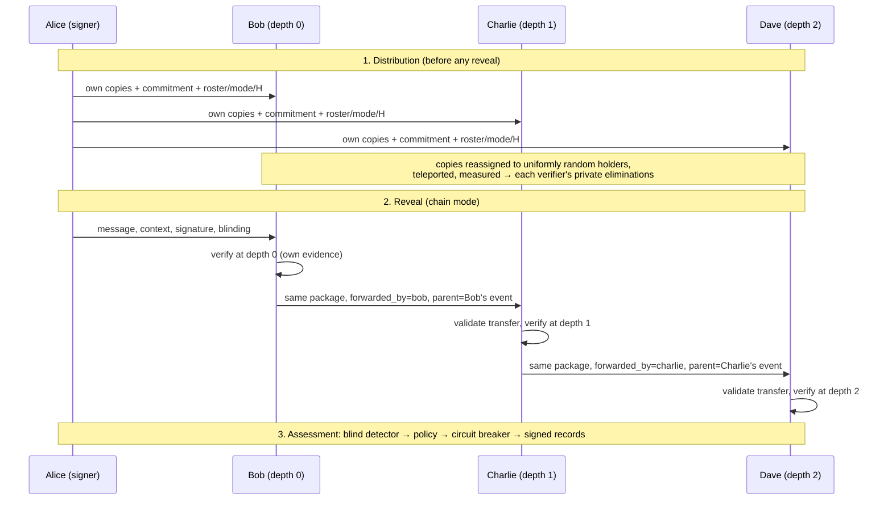

# N-Verifier Extension: How It Works and How It Is Built

This document explains the optional N-verifier extension of the HEDWIG teleportation-based QDS simulator:

- what it does and how a session runs;
- the security reasoning and statistics behind it;
- the code structure, records and interface;
- what was measured, and what it does **not** claim.

It implements [`QDS_N_Verifier_Implementation_Plan.md`](QDS_N_Verifier_Implementation_Plan.md), with these decision-gate choices:

| Decision (plan §) | Choice |
| :--- | :--- |
| Symmetrisation model (§8) | **Uniform final holder** |
| Depth-aware statistics (§9) | **Exact limits interpolated from k_fr (depth 0) to k_fa (depth H)**; legacy `s_l` schedule only as an experimental option |
| Q-Cert lifecycle (§13) | **Immutable linked records**: one signed record per forwarding event |
| First-release scope (§6) | N = 2–10; direct-to-all or one linear chain; H ≤ N − 1; one dishonest verifier per scenario; no collusion claims; forwarding stops on reject/inconclusive; extra verifiers shown on the admin page only |

---

## 1. Purpose in one paragraph

The original demo has one signer (Alice) and two verifiers (Bob and Charlie). The extension lets Alice serve a **fixed group of 2 to 10 pre-enrolled verifiers**. Each one independently checks the same signed message against **its own** quantum evidence. The message can be delivered to everyone at once, or passed along a **bounded forwarding chain** (for example, headquarters → regional office → branch office). This is about **recipient scalability**. It does not by itself improve detection, security, throughput or public verifiability. The default is still Alice + Bob + Charlie, and the project's main focus remains threat detection.

---

## 2. Key concepts

| Term | Meaning |
| :--- | :--- |
| **Roster** | The ordered list of verifier identities for one session, e.g. `bob, charlie, dave, erin`. Drawn from the enrolled pool `bob, charlie, dave, erin, frank, grace, heidi, ivan, judy, kim`. IDs are stable; display labels may change. |
| **N** | The number of verifiers in the roster (2–10). |
| **Delivery mode** | `direct`: Alice reveals the signature to every member. `chain`: Alice reveals to the first member only; each member that accepts passes the unchanged package to the next. |
| **Depth** | Position in the forwarding chain. A package received from Alice has depth 0; each forward adds 1. |
| **H** | The maximum forwarding depth. `direct` mode: H = 1 (one re-forward, as in the original Bob → Charlie transfer). `chain` mode: 1 ≤ H ≤ N − 1. |
| **Event** | One verification performed by one verifier, with a unique id and a link to its parent event. |
| **Session outcome** | The group-level result, derived from the per-verifier results (§6). |

N and H are separate settings. A chain that reaches all N members needs N − 1 forwards (H = N − 1). A smaller H stops the chain early, and the remaining members are reported as `outside_depth`.

---

## 3. End-to-end flow



### 3.1 Configuration (`roster.py`)

`SessionConfig.build(...)` creates and validates the setup **before any evidence is prepared**. These are rejected with `ConfigurationError` (HTTP 400 from the API):

- duplicate identities, or identities that aren't enrolled;
- N outside 2–10;
- an unknown delivery mode;
- `direct` mode with H ≠ 1;
- `chain` mode with H outside 1…N−1;
- a dishonest-forwarder scenario whose forwarder has nobody downstream within H;
- a chain-only scenario requested in `direct` mode.

The roster, delivery mode and H are written into the `SignedContext`, which is covered by Alice's commitment. Forwarders therefore cannot change them later without breaking the binding check.

### 3.2 Distribution (`protocol.py → distribute`)

1. Alice prepares **one copy of every signature position for each roster member**. Main and reserve positions are handled the same way. This is the plan's recommended resource model: the existing two-copy budget is not split across more people. As a result, distribution cost grows linearly with N.
2. **Symmetrisation (`symmetrisation.py`)** assigns each copy a private final holder:
   - N = 2 uses the original keep-or-forward swap. Each copy stays with probability ½, so existing behaviour and seeded tests are unchanged.
   - N > 2 uses `UniformHolderAssignment`. Each recipient sends each copy it was given to a holder drawn uniformly from the whole roster, itself included, so P(holder = v) = 1/N.
   - Invariants, checked by tests: no copy is duplicated or lost; each copy has one source, one position and one final holder; each verifier only evaluates copies assigned to it; Alice's signer operations (`reveal`, `open_reserve`) never read the assignment decisions.
3. Every copy is teleported through the channel and measured. Test tokens and sequential early abort run exactly as before.
4. Each roster member receives a `DistributionRecord` containing its eliminations, the commitment, the channel-test result and the **session configuration**. The session is also registered in the event ledger.

On average each verifier checks about one copy per position (≈ L copies), for any N. The **spread** widens with N, though. At L = 32 the per-verifier count ranged 26–38 at N = 2 but 17–51 at N = 10. So with many recipients, some individual verifiers get noticeably less evidence.

### 3.3 Reveal and delivery (`protocol.py → deliver_session`)

- **Direct:** `deliver()` reveals to every roster member. Each verifies independently and every result is kept, even when the group result is a failure.
- **Chain:** `deliver()` reveals to the first member. Then, hop by hop:
  - a hook decides whether to forward;
  - the default `honest_forwarding` forwards **the unchanged package** only after a local acceptance;
  - `forward()` sends it to the next member, naming the forwarder's latest event as the parent.
  - The chain stops at a rejection, an inconclusive result, or depth H. Members after that point are `not_reached`.

Forwarding is **classical package transfer**. No new quantum evidence is created after the reveal, and every downstream member checks against its own evidence from the distribution stage.

### 3.4 Verification of a forwarded package (`verifier.py`)

A verifier decides using only its own records, the package, the parent event as looked up in the ledger, and its own replay state and clock. For a forwarded package it first validates the **transfer**:

| Check | Fails when |
| :--- | :--- |
| Sender membership | The forwarder is not in this session's roster |
| Permitted edge | Sender → recipient is not an allowed step (chain: only consecutive members within depth H; direct: any pair at depth 1) |
| Depth consistency | The depth the package claims differs from the depth this edge actually has |
| Parent event | No event exists for the parent the package names, the parent belongs to another session or another participant, or the parent's depth isn't one less |
| Direct reveal in chain mode | Someone other than the first member receives a "direct" reveal |

**The applicable depth is worked out from the verifier's own record and the sender, never from the package.** An invalid transfer is evaluated under the **strictest (depth 0) rule** and rejected, so a false claim can never obtain a looser limit.

The usual checks then run unchanged: distribution record, sender, freshness and nonce, message digest, commitment, and elimination count. Then:

- **Duplicate deliveries:** each verifier evaluates at most **one forwarded delivery per session**, from any sender or route. Later ones are refused with `duplicate_delivery`, or `duplicate_nonce` if the nonce was already spent on that channel. They never open the reserve.
- **Reserve:** the precommitted reserve is opened at most `max_reserve_openings` times **per session across all channels** (this was per channel before). A borderline forwarded result asks Alice for the opening through the same path as direct delivery. If she can't provide it, the result stays `inconclusive`; no opening is ever fabricated.

---

## 4. Statistics: depth-aware acceptance rules

### 4.1 Default (exact) policy (`thresholds.py → depth_rule`)

The existing exact policy defines, for n checked copies:

- **k_fr**: the strictest mismatch limit that still meets the honest-reliability target (`fr_target`). This is the original direct rule.
- **k_fa**: the most permissive limit that still meets the forgery target (`fa_target`). This is the original forwarded rule.

With depth l from 0 to H:

```
limit(l) = k_fr + floor( l · (k_fa − k_fr) / H )
```

- depth 0 → k_fr and depth H → k_fa; **H = 1 reproduces the original direct/forwarded rules exactly**;
- the limit never decreases with depth, and every level lies in [k_fr, k_fa], so every level meets **both** risk targets whenever the endpoints do;
- **two-stage (reserve) designs** keep the direct stage-1 limits and widen only the pooled limit a2, clamped to the largest value that still meets the forgery target;
- **when the evidence is too thin**, i.e. in the inconclusive band or below the targets even with the reserve, the intermediate levels **keep the direct rule**. No margin is granted that the evidence can't support.

Every event records the rule actually applied: depth, H, limits, and the exact false-reject and forgery-accept probabilities.

**Effect of sample size (stage-1 limits, depth 0 … H):**

| Checked copies | H = 1 | H = 3 | H = 9 |
| :--- | :--- | :--- | :--- |
| 32 | [0, 0] | [0, 0, 0, 0] | all 0 (below target) |
| 64 | [3, 3] | [3, 3, 3, 3] | all 3 |
| 128 | [4, 11] | [4, 6, 8, 11] | [4, 4, 5, 6, 7, 7, 8, 9, 10, 11] |
| 256 | [7, 28] | [7, 14, 21, 28] | [7, 9, 11, 14, 16, 18, 21, 23, 25, 28] |

At L ≤ 64, the integer limits coincide at every depth: there isn't enough evidence for a transfer margin, and this is reported honestly. The dashboard caps L at 64, so in the UI every depth currently shows the same limit. Distinct limits by depth appear from about L ≈ 128.

### 4.2 Experimental legacy schedule

With `threshold_policy="legacy"` only, the plan's proposed rate schedule is available:

```
s_l = μ_h + (l + 1) · (p_min − μ_h) / (H + 2)
```

H = 1 gives back the original s_a and s_v. The schedule is labelled *experimental* in every report it appears in (`schedule_status`), because it is not an established multiparty result and its gaps shrink as H grows.

---

## 5. Threat scenarios

The original nine scenarios still work, now under any roster. For example, `repudiation` tampers with the copies prepared for the second half of the roster, and `impersonation` addresses the whole roster. Five new scenarios cover forwarding. In each, **one** verifier is dishonest; collusion is not modelled.

| Scenario | What the injector does | What is observed | Classification / response |
| :--- | :--- | :--- | :--- |
| `dishonest_forwarder` | The selected verifier receives the genuine package, then changes the **message** or the **signature** and forwards it | The next honest recipient rejects it: digest mismatch (message) or commitment mismatch (signature). Later members are `not_reached` | `DISHONEST_VERIFIER_FORGERY` |
| `forward_withheld` (chain) | The selected verifier accepts but never forwards | Later members `not_reached`; session `incomplete` | Not treated as forgery |
| `route_manipulation` (chain) | The selected verifier forwards the genuine package but claims a deeper depth | Transfer invalid → evaluated at depth 0 and rejected | `INVALID_TRANSFER` (classical; link not locked) |
| `forward_replay` | A recipient that already verified a forwarded copy receives the package again (from another sender in direct mode) | Refused as a duplicate without opening the reserve | `REPLAY_ATTACK` |
| `unknown_forwarder` | An identity that is not enrolled (`mallory`) forwards the genuine package | Transfer invalid: sender not in roster, no parent | `INVALID_TRANSFER` |

"Caught at the next level" means the next honest recipient that is reached **rejects the altered package under the integrity checks**. It does not mean every alteration triggers a statistical rejection, that colluders expose each other, or that withholding is detected as forgery.

**Detection stays blind.** `detection.py` still sees only verification results and the channel test. The new rule is: a forwarded result whose transfer is invalid but whose binding is intact → `INVALID_TRANSFER`. That rule sits *after* the forwarded-forgery rule, so the original `dishonest_bob` scenario is classified as before. Ground truth, now including `dishonest_verifier`, is attached only after detection has finished. `INVALID_TRANSFER` is in the policy's classical-only set: anyone can trigger it at will, so it must not lock out the honest signer.

---

## 6. Outcomes

**Per verifier** (`VerificationResult.status`, plus `ledger.participant_matrix`):

| Status | Meaning |
| :--- | :--- |
| `accepted` | All checks passed |
| `rejected` | A binding, freshness, transfer, identity or decisive elimination check failed |
| `inconclusive` | The package is otherwise genuine, but the mismatch count is in the borderline band and no reserve could resolve it |
| `distribution_aborted` | The channel test or loss check aborted the session; nothing was revealed |
| `not_reached` | The chain stopped before this member |
| `outside_depth` | The member is beyond depth H in the chain |

**Per session** (`ledger.session_outcome`), with no majority rule:

| Outcome | Rule |
| :--- | :--- |
| `all_accepted` | Every required recipient (whole roster in direct mode; route up to H in chain mode) accepted |
| `rejected` | At least one reached recipient rejected |
| `inconclusive` | None rejected, at least one inconclusive |
| `incomplete` | None rejected or inconclusive, but some required recipient was not reached |
| `distribution_aborted` | The signature was never revealed |

---

## 7. Records and certificates

### 7.1 Event ledger and SQLite (`ledger.py`, `store.py`)

- Every verification becomes an **event** with a unique `event_id`, the session, the verifier, the sender, mode, depth, `parent_event_id`, status, counts, the applied rule, reserve status, per-event risk values and reasons.
- Events are **never keyed by verifier + mode**, so repeated events never overwrite each other. Writes are insert-only (`INSERT OR IGNORE`).
- New tables are `sessions` (roster/configuration, written once) and `verification_events` (indexed by session). Each event is linked to its transmission id after assessment.
- After a restart the **history** is still available, but the one-time quantum evidence is not (as before). A pending session therefore fails clearly (`record_found = false`) and must be redistributed.

### 7.2 Q-Cert v3 (`audit.py`)

| Record | Content |
| :--- | :--- |
| `transaction` (`hedwig-audit/3`) | As before, plus `session.config` (roster, mode, H), `session.outcome`, a participant summary, the reveal events, and `events_sha3_256` (evidence digests keyed by event id) |
| `transfer` (new) | One per chain forwarding event: sender, recipient, depth, validation result, decision and applied rule, the **unchanged original signed context**, and `parent_record = {artifact_id, payload_sha256}` of the record holding the parent event |

Records are immutable and linked: a signed record is never changed, and a chain of N members produces one transaction record plus N − 1 transfer records, each pointing to its parent. Everything shares the existing append-only hash chain.

**Migration:** the verifier accepts both `hedwig-audit/2` and `/3`, and recomputes each version's evidence digests with **that version's rules**, so old certificates still verify unchanged.

A valid certificate signature authenticates the **audit record**. It does not give the reader the private evidence needed to perform QDS verification themselves.

---

## 8. Routing and enforcement (`router.py`)

- The signer route is redrawn for each session as a star `alice → QR-1 → v` over the current roster. Each forwarding edge actually used (e.g. `charlie->dave`) gets its own classical hop.
- **Isolation granularity:** the circuit breaker still acts on the two *logical* links, signer distribution and pooled verifier transfers. The channel test is pooled over the whole stream and transfer evidence is classical, so per-hop counters show traffic but are **not** used to attribute blame to an individual edge.
- One failed forwarding edge does not quarantine every recipient by itself. The existing rule still applies: once any link is quarantined, all traffic is refused until an admin resets it.

---

## 9. Server API and access control (`server.py`)

`POST /api/sign-and-send` accepts these optional fields; leaving them out gives the original Bob + Charlie behaviour:

```jsonc
{
  "message_text": "HQ instruction",
  "n_bits": 32,
  "n_verifiers": 5,               // or "roster": ["bob","charlie","dave","erin","frank"]
  "delivery": "chain",             // "direct" | "chain"
  "max_depth": 4,                  // default: 1 (direct) or N-1 (chain)
  "threat_type": "dishonest_forwarder",
  "dishonest_verifier": "charlie",
  "forward_alteration": "message"  // "message" | "signature"
}
```

| Endpoint | Role | Purpose |
| :--- | :--- | :--- |
| `GET /api/roster` | Admin | Enrolled identities, limits, scope statement |
| `GET /api/sessions/{id}/events` | Admin | Durable roster and full event history of a session |

**Who sees what (`view_for`):**

- **Admin** sees everything.
- **Bob and Charlie** see only Bob and Charlie entries. Extra recipients, the other verifier's private evidence (`eliminated_states`, `held_tokens`), symmetrisation decisions and ground truth are removed.

---

## 10. Admin interface

- **Recipient group** (in the compose form): N, delivery mode, H (filled in automatically from N and mode), and, for forwarding scenarios, the dishonest forwarder (only members with someone downstream are offered) and the alteration.
- **Threat cards 10–14:** the new scenarios.
- **Recipient matrix · latest session** (directly under the threat studio): one row per participant, showing route role, status, sender, depth, mismatches/checked ≤ limit, reserve and stage, assurance status and first reason. A history button lists that verifier's durable events, including parent links and per-event risks.
- **Dispatch feed:** every entry lists every verifier's result (`Dave via Charlie: REJECTED …`, `Erin: not reached`), plus N, mode, H and the session outcome.
- **Router diagram:** redraws for the current roster, with distribution (solid) and transfer (dashed) edges kept separate.
- **Bob and Charlie terminals** are unchanged. Extra verifiers have no terminal of their own in this release.

---

## 11. Code map

| File | Role in the extension |
| :--- | :--- |
| `src/quantum_engine/roster.py` *(new)* | `SessionConfig`, the enrolled pool, validation, route rules (`expected_depth`, `next_hop`, …) |
| `src/quantum_engine/ledger.py` *(new)* | `EventLedger`, `event_summary`, `participant_matrix`, `session_outcome` |
| `src/quantum_engine/symmetrisation.py` | `UniformHolderAssignment` (N > 2) |
| `src/quantum_engine/binding.py` | `SignedContext.delivery/max_depth`; package transfer metadata (`depth`, `parent_event_id`, unsigned) |
| `src/quantum_engine/protocol.py` | Roster-aware `distribute`; `deliver_session`, `forward`, `honest_forwarding`; lazily created verifier nodes; transfer-record issuing |
| `src/quantum_engine/verifier.py` | Transfer validation, depth-derived rule, duplicate refusal, per-session reserve bound, event fields and status |
| `src/quantum_engine/thresholds.py`, `security.py` | `depth_rule`, depth-aware `elimination_rule`, experimental legacy schedule, reporting |
| `src/quantum_engine/threats.py` | Five forwarding scenarios, scenario/configuration validation, N-party repudiation |
| `src/quantum_engine/detection.py`, `policy.py` | `INVALID_TRANSFER` classification (classical-only response) |
| `src/quantum_engine/audit.py` | `hedwig-audit/3`, `build_transfer_record`, version-aware verification |
| `src/quantum_engine/store.py` | `sessions` and `verification_events` tables |
| `src/quantum_engine/router.py` | Roster-specific signer hops, per-edge transfer hops |
| `server.py` | Request fields, 400 on configuration errors, role-filtered views, new endpoints |
| `templates/admin.html`, `static/js/admin.js`, `static/css/components.css` | Controls, scenario cards, recipient matrix, event history, N-node topology |
| `tests/test_n_verifier.py` *(new)*, `tests/test_api.py` | Functional, compatibility, attack, record and access tests |
| `experiments/n_verifier_eval.py` *(new)* | Phase 6 evaluation → `n_verifier_eval.md/.json` |

---

## 12. Testing and evaluation

Run the tests:

```bash
python -m pytest tests -q                 # 270 passed, 1 skipped at the time of writing
python -m pytest tests/test_n_verifier.py -v
```

The new tests cover:

- configuration rejection;
- context binding of roster/mode/H;
- copy conservation and uniform holder probabilities (including N = 2 equivalence);
- per-verifier evidence ownership;
- H = 1 reproducing the original rules, monotone depth limits, and no invented thresholds;
- honest direct delivery for N = 2, 3, 5, 10 and honest chains for N = 3, 5, 10;
- the depth bound;
- every new attack;
- substituted or invented parents;
- the per-session reserve bound;
- linked, verifiable transfer records;
- history surviving a restart;
- v2 certificate compatibility;
- API access isolation.

Run the evaluation:

```bash
python experiments/n_verifier_eval.py --trials 40 --seed 2026
```

**Results** (seed 2026, 40 trials per setting, statevector backend, default depolarising channel):

| Measure | Result |
| :--- | :--- |
| Honest per-event acceptance | 98.7–100% across N = 2–10, L = 32/64, both modes; occasional L = 32 rejections match the baseline's known honest-noise rate |
| Altered package accepted by the next recipient | **0/160** (N = 3 and 10 × message and signature) |
| Rejection cause | Message change → digest (40/40 per setting); signature change → commitment (40/40) |
| Planned tokens at L = 64 | 162 (N = 2) → 354 (N = 5) → 674 (N = 10): linear in N |
| Median total run time at L = 64 (statevector) | ≈ 94 ms (N = 2) → ≈ 520 ms (N = 10 chain); Qiskit backend ≈ 0.47 s → 1.85 s |
| Audit size (transaction + transfer records) | ≈ 9 kB (N = 2) → ≈ 47 kB (N = 10 chain) |

These finite trials do not prove zero forgery probability. Latency is simulator wall time on one host, not hardware timing.

---

## 13. Limitations and non-claims

- **Adding recipients does not add security.** This is not universal (public) verification like RSA or ECC, and not multi-signer, voting or threshold approval.
- **Collusion is not covered.** Only one dishonest verifier per scenario is modelled.
- **No aggregate session-level risk bound.** Risks are per event; all recipients' evidence comes from one distribution and is not independent, so agreement between recipients is not independent corroboration.
- **A rejection does not identify the culprit.** A statistical or route failure alone doesn't show which participant caused it.
- **Transfer margin needs evidence.** Depth limits only separate from about L ≈ 128. With the dashboard's L ≤ 64 cap, all depths show the same limit.
- **Uneven evidence per verifier.** Holder counts vary more as N grows, so individual verifiers can receive noticeably fewer copies.
- **Coarse quarantine.** It acts on two logical links, not on individual forwarding edges.
- **No dynamic enrolment.** Membership changes apply only to future sessions; there is no enrolment after distribution.
- **Admin-only visibility.** Extra verifiers have no terminal of their own in this release. Admin visibility is part of the simulation's trust boundary and is not a secrecy guarantee against a real-world operator.
- **Not a proof.** Published multiparty QDS work (e.g. [arXiv:1505.07509](https://arxiv.org/abs/1505.07509)) is a reference for the analysis, not a security proof for this codebase.
