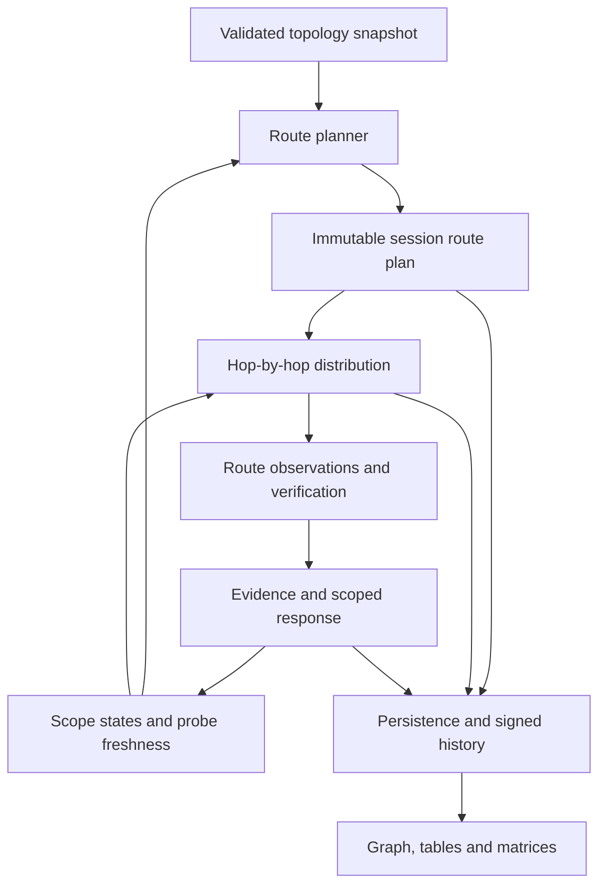
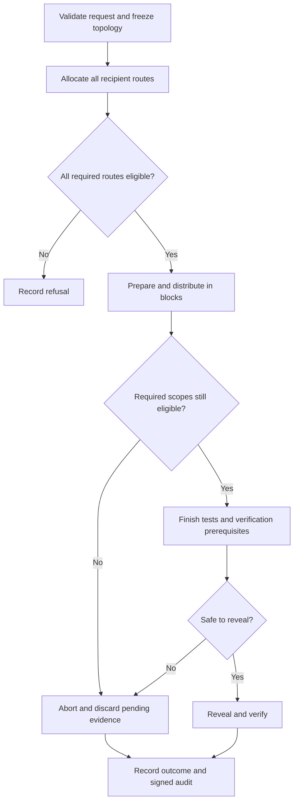
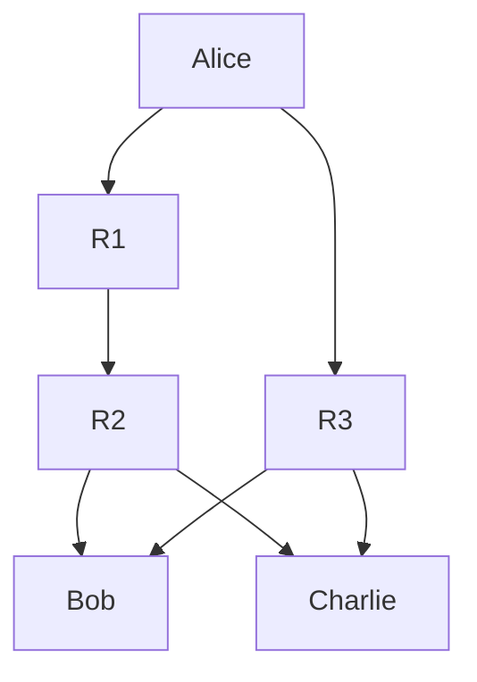
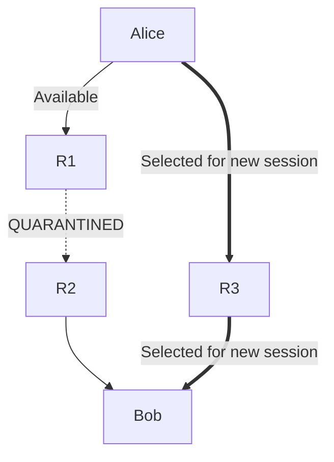

# QDS Alternate Quantum Routing: Implementation and Visualisation Guide

Date: 30 October 2026  
Project: Team Athena — Hedwig Teleportation QDS  
Repository: https://github.com/miki-dev-5618/QDS  
Branch reviewed: `verif-eff`  
Reviewed baseline: `eff89cd9d31e8d6d7ca2c72b287ebe89f2d52cf2` — “Multi-hop routing”  
Document type: implementation blueprint; algorithms, internal APIs and code remain for independent implementation.

> This guide is grounded in the commit already reviewed in this conversation. It does not assert that the branch has remained unchanged since that inspection. Features below are requirements or recommendations unless explicitly marked as observed implementation.

## 1. Main objective

Allocate an acceptable alternative quantum distribution route when the preferred route becomes unavailable or restricted. Continue distribution to the required verifier roster when an acceptable route exists; otherwise refuse with a clear explanation before spending distribution resources.

The central capability is alternate route allocation. Threat detection supplies evidence that can restrict a route or edge. Monitoring, statistics, persistence and visualisation make allocation defensible and reviewable.

### Goals and observable outcomes

| Goal | Observable outcome |
| --- | --- |
| Preserve availability | A new session uses an eligible alternative after a primary edge is quarantined |
| Contain faults locally | An unrelated edge restriction does not block an unaffected session |
| Preserve verification assurance | Route noise and loss influence budgets and acceptance policy |
| Explain decisions | Selected and rejected routes have recorded reasons |
| Show actual activity | Graphs and tables distinguish planned, attempted, completed and aborted routes |
| Preserve history | Old sessions display their original topology and route snapshots |
| Maintain evidence boundaries | Manual faults and injected attacks never masquerade as detector evidence |

### Scope boundaries

- Software simulation of teleportation-based distribution; no physical network switching claim.
- Each quantum edge is a teleportation hop using a Bell pair and classical correction bits.
- Relays follow the protocol; malicious or colluding relay resistance is outside this release.
- Authenticated classical communication is assumed available. Its authentication mechanism and assumptions must be documented.
- Classical signature forwarding depth and quantum relay hop count are separate quantities.
- A blocked in-flight session aborts. Failover uses a fresh session, fresh preparation and fresh evidence; no partially transmitted state is migrated.
- Quantum states are not copied at a branching relay. Distinct prepared signature copies traverse their assigned routes.

## 2. Current baseline and missing work

| Area | Observed at reviewed commit | Required work |
| --- | --- | --- |
| Topology model | `topology.py`, JSON demo and path enumeration exist | Harden validation, identity, immutability and search bounds |
| Scope helpers | Edge/path naming and exception helpers exist | Complete enforcement behavior and migration |
| Enforcement | `check_open` still scans all links and globally refuses on quarantine | Check only scopes required by an operation plus explicit emergency stop |
| Route planner | No `routing.py` in reviewed tree | Implement deterministic policy-based allocation |
| Edge probes | No `monitoring.py` in reviewed tree | Implement independent observations and calibrated decisions |
| Distribution | Fixed star configuration; one teleportation job per token | Assign routes and propagate state through each selected hop |
| Statistics | Shared session channel test | Route-aware observations, budgets and decisions |
| Router counters | Full session count added to every active star hop | Count actual edge traversal and loss |
| Route displays | No integrated selected multi-hop route view | Add graph, session route table, matrices and history |
| Audit/persistence | Existing infrastructure available | Extend with immutable route and observation records |

The repository implementation document itself identifies most multi-hop integration as designed rather than running. Updated docstrings must not be treated as proof of implemented behavior.

## 3. Target architecture

Maintain one authoritative topology model and one recorded route plan per session. UI components must consume those records rather than reconstructing routes from counters or current configuration.

## 4. Topology model and identity

### Required model

A topology contains its schema version, human-readable version, canonical digest, nodes, directed quantum edges and supported hop bound. Each edge declares calibrated honest noise, loss and routing cost. Hidden attack parameters are stored separately.

Use exactly one active signer in this release, or explicitly bind signer identity throughout route planning if supporting multiple signers. The current validator's “at least one signer” rule is insufficient for APIs that default to `alice`.

### Validation requirements

Reject malformed collections and entries with a domain-specific validation error, not raw `AttributeError`, `TypeError` or `KeyError`.

- Require object-shaped topology documents and array-shaped node/edge collections.
- Require nonempty string node and edge identifiers; validate label types and length bounds.
- Reject duplicate IDs, unknown endpoints, self-edges and unsupported parallel edges.
- Reject edges entering a signer and leaving a verifier.
- Verify enrolled verifier identities and supported node roles.
- Reject booleans as integer hop counts or numeric parameters.
- Require finite probabilities within documented ranges and finite positive costs.
- Bound total nodes, edges, route-search expansions and candidates.
- Handle cycles with simple paths and hop limits.
- Distinguish a structurally valid but unreachable recipient from an invalid topology.

### Immutable snapshots

Freeze the full topology, including nested mappings and adjacency structures. Freezing only individual edge objects is insufficient. Changes produce a new snapshot, digest and activation event. In-flight sessions retain their old snapshot.

Canonical serialization must sort both nodes and edges by stable IDs. Object-key sorting alone does not canonicalize arrays. Decide whether descriptions and display labels belong in the operational digest; document the decision consistently.

### Scope identifiers

Do not join arbitrary edge IDs with an unescaped delimiter. The sequences `["a|b", "c"]` and `["a", "b|c"]` currently yield identical joined path strings.

Define scope identity from a canonical structured representation including topology identity and the ordered edge sequence. Hashing that representation is one option; retaining readable fields alongside it improves inspection. Reusing an edge label in a different topology must not silently inherit an unrelated restriction.

## 5. Route allocation policy

### Preflight inputs

- Frozen topology and signer identity.
- Signed verifier roster and delivery configuration.
- Current scope states and their revision.
- Probe observations, timestamps and calibration versions.
- Declared honest channel model.
- Routing policy and verification assurance targets.

### Eligibility

| Condition | Recommended treatment |
| --- | --- |
| Explicit emergency stop | Refuse all relevant operations |
| Signer scope quarantined | Refuse new distribution/reveal for that signer |
| Required edge or exact path quarantined | Exclude that candidate |
| OPEN with fresh acceptable monitoring | Prefer |
| RESET_PENDING | Allow only under an explicit probation policy with monitoring |
| WATCH | Default to exclusion; permit only explicit fallback and record it |
| No probe or stale probe | Mark unmonitored/stale; eligibility must be a visible policy choice |
| Excessive expected honest error or insufficient survival | Mark policy-unacceptable |
| No physical path | Mark unreachable |
| Search work bound reached | Mark search incomplete; do not assert disconnection |

An OPEN state means no active restriction. It is not proof that an edge is healthy. Monitoring freshness is a separate field.

### Selection behavior

1. Validate the complete roster before preparing tokens.
2. Find candidates while pruning prohibited edges and honoring the hop limit.
3. Reject policy-unacceptable candidates using the route's calibrated channel model.
4. Rank eligible candidates by a documented deterministic priority: monitoring/state class, assurance margin, resource cost, then stable tie-breaker.
5. Allocate a route to every required verifier.
6. Freeze the plan and its decision explanations.
7. If any required verifier cannot be served, refuse the whole session under the initial all-or-nothing policy.

Do not enumerate the first fixed number of depth-first paths and then declare failure after filtering. A usable path may occur beyond the cutoff. Use a bounded cost-aware search or another method with explicit completeness semantics. Choose the implementation independently; test the required behavior.

Shared edges require consistent state reads across recipient allocation. Capacity-aware scheduling can be a later extension, but resource accounting must already recognize repeated use of shared edges.

## 6. Session lifecycle and concurrency

### Required invariants

- No preparation before successful roster-wide route preflight.
- Revalidate relevant scopes before each transmission block and immediately before reveal.
- Revalidation checks the frozen plan; it must not silently replace the route mid-session.
- A restriction observed during distribution causes an explicit route abort.
- Report tokens already attempted; do not imply an atomic rewind.
- Do not release partial verifier records as valid completed evidence.
- Retrying creates a new session and preparation. An optional retry-group ID may connect attempts for display.
- Probe sessions and user sessions use distinct identifiers and accounting.
- Repeated assessment of the same evidence must not produce duplicate strikes or incidents.

Use revisioned scope snapshots and defined synchronization boundaries to address the race between checking a scope and sending a block. Document the maximum block of work that may already be in flight when quarantine occurs. Existing process-local locks must not be presented as cross-process coordination if the server runs multiple workers.

## 7. Hop-by-hop quantum simulation

For each token, retain its route assignment and propagate its state through the selected edges in order. At each hop, simulate teleportation and correction, then apply the documented channel operations at their defined locations. Carry the resulting quantum state into the next hop. Measure for verifier evidence only at the destination under the protocol's measurement rule.

Do not measure an intermediate state and recreate a known preparation label as a shortcut. That would change the protocol and potentially leak signer knowledge to relays. An optimized simulation is acceptable only when equivalence to the faithful channel model is established for its supported assumptions.

### Noise and loss

- Specify the order of depolarization, damping, interception and correction operations.
- Keep honest calibrated parameters separate from hidden attack injections.
- Heralded loss ends that token's traversal; downstream edges receive no token for that attempt.
- Loss contributes to availability and evidence sufficiency, not mismatch count.
- Define exactly when Bell-pair resources are consumed and what counters mean.
- Support backend-independent event semantics so statevector and Qiskit implementations can be compared.

### Correct the damping approximation

The reviewed topology code uses `gamma / 4` for amplitude-damping error. For uniform BB84 inputs through a single standard amplitude-damping channel, average matched-basis error is:

`p_error = (gamma + 1 - sqrt(1 - gamma)) / 4`

At `gamma = 0.2`, this gives approximately `0.07639`, while `gamma / 4` gives `0.05`. This formula is conditional on the stated channel and input ensemble; damping applied to Bell-pair qubits or other locations requires deriving the corresponding model.

Do not compose arbitrary quantum channels by multiplying or combining scalar QBERs. Independent symmetric flip models permit `e <- e + f - 2ef`; amplitude damping is state-dependent and requires a suitable channel representation. For independent heralded edge losses, route survival is the product of per-edge survival probabilities.

## 8. Route-aware verification and monitoring

### Test assignment

Assign every sacrificed test token to a specific recipient route. Retain route ID, calibration version, planned count, observed count, losses and errors. Signature and reserve evidence must use a compatible route model.

Plan budgets before transmission using expected honest noise, expected loss and assurance targets. Previous observed loss may inform planning, but realized post-selection changes must not invalidate the statistical rule.

### Statistical requirements

- Derive thresholds from the actual route and basis model.
- Require minimum surviving evidence per recipient and, where needed, per basis or signature segment.
- Global survival alone must not hide complete evidence loss at one recipient.
- Distinguish accepted, rejected, inconclusive and aborted results.
- Calibrate early stopping for the actual sample plan and loss treatment.
- Use exact Poisson-binomial calculations, separately controlled route tests, or a justified bound when samples have heterogeneous null probabilities.
- Do not assume a binomial test using mean QBER is universally conservative.
- Account for simultaneous edge tests and repeated monitoring rounds. Per-round correction alone does not bound lifetime false alarms.
- Validate dependence assumptions before combining repeated p-values, especially when sessions share edges or evidence.

### Edge probes and attribution

Independent probe observations may update an edge's detector-driven state. End-to-end route observations establish a route disturbance, not the specific faulty edge.

If a pooled test cannot distinguish which route is disturbed, record the candidate route set and uncertainty. Any broad containment must be explicitly described as conservative policy, not localized proof.

| Evidence or event | Appropriate scope |
| --- | --- |
| Independent edge probe anomaly | That topology-specific edge |
| Route-specific channel anomaly | That recorded path |
| Pooled channel anomaly | Uncertain affected route set; conservative response explicitly labeled |
| Signer forgery or repudiation evidence | Signer/session scope under response policy |
| Classical verifier forwarding misconduct | Forwarding scope |
| Replay, impersonation or integrity rejection | Reject and log; do not invent a quantum-edge fault |
| Manual admin fault | Target scope, labeled manual injection |

Reset should enter monitored probation. Define an adequate recovery evidence budget; one small passing probe must not automatically imply strong recovery confidence.

## 9. Visual network graph

The following diagrams are illustrative requirements, not evidence of completed routing in the reviewed code.

### Available topology

### Example selected route after a fault

### Interactive graph requirements

- Label signer, relays and verifiers explicitly.
- Use directed edges and text labels for state; color must not be the only distinction.
- Keep edge restriction state, monitoring freshness and route selection visually separate.
- Highlight the selected recipient's route, with optional comparison against its previous route.
- Show hop order, predicted error/survival and observed traffic on selection.
- Keep experimental attack controls in a clearly labeled ground-truth panel.
- Never infer an edge fault from a red end-to-end result.
- Display session ID, topology version/digest, plan status and observation time.
- Distinguish a planned path from completed traversal. Mark the stopping edge on an abort.
- Historical view must use the stored topology and route snapshot.

## 10. Route tables and matrices

All values below are illustrative. Use explicit legends and timestamps in the implemented UI.

### A. Per-session route allocation table — primary display

| Session | Recipient | Selected path | Hops | Allocation reason | Execution status |
| --- | --- | --- | ---: | --- | --- |
| S-001 | Bob | Alice → R1 → R2 → Bob | 3 | Preferred eligible route | Completed |
| S-001 | Charlie | Alice → R1 → R2 → Charlie | 3 | Preferred eligible route | Completed |
| S-002 | Bob | Alice → R3 → Bob | 2 | R1→R2 quarantined | Completed |
| S-002 | Charlie | Alice → R3 → Charlie | 2 | R1→R2 quarantined | Aborted during distribution |

Add fields or expandable detail for topology digest, route ID, plan creation time, previous route reference, expected QBER, expected survival, monitoring status, fallback use, decision policy and refusal explanation.

S-002's recipient rows describe physical distribution progress. Under all-or-nothing completion, Charlie's abort means the session must not reveal or be displayed as successfully delivered merely because Bob's distribution finished.

### B. Directed adjacency/state matrix — available connectivity

Rows are source nodes; columns are destinations. `O` = OPEN, `Q` = QUARANTINED, `—` = no directed edge. O means unrestricted, not proven healthy.

| From / To | Alice | R1 | R2 | R3 | Bob | Charlie |
| --- | --- | --- | --- | --- | --- | --- |
| Alice | — | O | — | O | — | — |
| R1 | — | — | Q | — | — | — |
| R2 | — | — | — | — | O | O |
| R3 | — | — | — | — | O | O |
| Bob | — | — | — | — | — | — |
| Charlie | — | — | — | — | — | — |

This matrix shows what can be considered for routing; it does not establish which route was taken. Include freshness and evidence details on inspection, rather than packing every attribute into one cell.

### C. Selected-route incidence matrix — edges actually allocated

`1` = edge included in that recorded plan; `0` = not included. Separate observed traversal metrics establish execution.

| Session / Recipient | A→R1 | R1→R2 | R2→Bob | R2→Charlie | A→R3 | R3→Bob | R3→Charlie |
| --- | ---: | ---: | ---: | ---: | ---: | ---: | ---: |
| S-001 / Bob | 1 | 1 | 1 | 0 | 0 | 0 | 0 |
| S-001 / Charlie | 1 | 1 | 0 | 1 | 0 | 0 | 0 |
| S-002 / Bob | 0 | 0 | 0 | 0 | 1 | 1 | 0 |
| S-002 / Charlie | 0 | 0 | 0 | 0 | 1 | 0 | 1 |

This is the most direct matrix for answering “which route was allocated?” Pair it with completion status to answer “which route was actually traversed?”

### D. Candidate evaluation table — why this route?

| Candidate for Bob | Scope state | Monitoring | Policy suitability | Decision |
| --- | --- | --- | --- | --- |
| Alice → R1 → R2 → Bob | R1→R2 quarantined | Fresh adverse probe | Blocked | Excluded |
| Alice → R3 → Bob | OPEN | Fresh acceptable probes | Within error/loss limits | Selected |
| Hypothetical longer path | OPEN | Stale | Outside survival limit | Policy-unacceptable |

### E. Edge execution table — actual resource use

| Session | Edge | Attempted tokens | Received tokens | Lost tokens | Bell pairs consumed | Evidence source |
| --- | --- | ---: | ---: | ---: | ---: | --- |
| Example | Alice→R3 | 100 | 98 | 2 | 100 | Session execution |
| Example | R3→Bob | 98 | 97 | 1 | 98 | Session execution |

Counts illustrate one token stream and a consume-on-attempt Bell-pair convention. Additional recipient copies and probe traffic need separate accounting. Do not add the entire session stream to every branch.

### F. Reroute history

| Retry group | Previous session | New session | Old path | New path | Trigger |
| --- | --- | --- | --- | --- | --- |
| G-001 | S-001 | S-002 | Alice→R1→R2→Bob | Alice→R3→Bob | Edge restriction changed |

Only claim a reroute when there is a defined prior route reference. First-time selection of an alternative to an excluded preferred candidate should be labeled fallback allocation if no prior session used the old path.

## 11. Data contracts and persistence

These are conceptual records, not mandated class definitions.

| Record | Minimum required content |
| --- | --- |
| Topology snapshot | Schema, version, canonical digest, validated nodes/edges, creation and activation metadata |
| Session route plan | Session ID, topology digest, signer, roster, per-recipient ordered edges, policy version, state revision, predictions and selection reasons |
| Candidate decision | Candidate identity, exclusion/ranking reasons, search bounds and completeness status |
| Edge observation | Edge/topology identity, probe/session ID, counts, basis information, calibration, timestamps, statistical rule and result |
| Execution summary | Planned/attempted/completed route, per-edge counters, losses, abort location and reason |
| Scope transition | Scope, old/new state, evidence reference, actor, policy, timestamp and incident ID |
| Retry/reroute record | Related sessions, old/new routes and trigger evidence |

Persist snapshots and transitions atomically where needed. Restore restrictions after restart. Migration must preserve legacy pooled restrictions without inventing edge attribution. Keep a migration marker and test idempotence.

Sign audit payloads containing the topology digest, recorded plan, relevant observations, decisions, fallback flags and execution outcome. Later probes or resets produce new records; never rewrite previously signed history. Verify historical records using their stored bytes and schema versions.

## 12. API and UI integration

Suggested endpoint responsibilities; exact URLs may follow existing conventions.

| Capability | Access | Behavior |
| --- | --- | --- |
| Read active topology | Role-filtered | Return topology identity, edge state and freshness |
| Activate topology | Admin | Validate and activate for future sessions |
| Read session routes | Authorized participant/admin | Return persisted plan and execution summary |
| Probe edges | Admin/controlled scheduler | Generate independent monitoring evidence |
| Inject manual fault | Admin | Label actor, reason and experimental nature |
| Reset scope | Admin | Enter monitored probation |
| Set emergency stop | Admin | Persist explicit global stop and transition |
| Read reroute history | Authorized | Return linked session records |

Refusal payloads should include operation, affected recipients, topology digest, blocking scopes, candidate rejection reasons and search completeness. Keep invalid input, physical unreachability, policy refusal and temporary quarantine distinguishable even if some share an HTTP status.

The proposed project design uses HTTP 423 for active restriction/no eligible route. Retain consistent existing conventions where appropriate; do not let the status code replace a precise machine-readable reason.

Hide unauthorized participants' route details and experimental ground truth. Build UI labels from structured records, not exception-message parsing. Display unavailable history honestly rather than reconstructing it from the active graph.

## 13. Module responsibilities

| Module | Required direction |
| --- | --- |
| `topology.py` | Validation, immutable snapshots, canonical identity, bounded graph queries |
| `enforcement.py` | Required-scope checks, emergency state, migration, probation and idempotent transitions |
| New `routing.py` | Candidate eligibility, ranking, plans, refusal explanations and search completeness |
| `teleportation.py` | Ordered multi-hop state propagation and backend equivalence |
| `channel.py` | Explicit honest edge models and separate hidden injections |
| `protocol.py` | Preflight, route assignment, block revalidation, abort/retry lifecycle and reveal gate |
| `verifier.py` | Route-calibrated evidence thresholds and recipient sufficiency |
| New `monitoring.py` | Independent probes, freshness and repeated-testing policy |
| `router.py` | Actual edge activity and resource counters |
| `store.py` | Route snapshots, observations, transitions and restart recovery |
| `audit.py` | Signed route and execution provenance |
| `server.py` | Authorized endpoints and structured refusal responses |
| Admin templates/scripts | Graph, allocation table, matrices and recorded history |

Keep planning separate from side effects. A planner must not prepare tokens, mutate evidence or clear restrictions while searching.

## 14. Delivery phases and acceptance gates

### Phase 1 — trustworthy foundations

Harden topology validation and identity; remove mutable snapshot behavior; define unambiguous scope keys; implement scoped enforcement and migration.

Exit: equivalent reordered topology documents have the intended identical identity; malformed input fails clearly; unrelated quarantine does not stop traffic; legacy restrictions survive restart.

### Phase 2 — alternate allocation with manual failures

Implement the planner and integrate preflight. Provide a route allocation table and candidate decision view using real plans. Manual fault injection is acceptable at this stage when visibly labeled.

Exit: restricting R1→R2 changes a new session's plan to R3; all routes blocked produces a refusal before token preparation; a valid candidate beyond the old DFS cutoff can be found or the search is honestly marked incomplete.

### Phase 3 — faithful execution and resource accounting

Integrate hop-by-hop simulation, edge loss and route-aware budgets. Add block revalidation and the pre-reveal gate. Record actual traversal and abort state.

Exit: noiseless routes preserve states across supported backends; calibrated noise predictions match simulation within stated uncertainty; upstream losses do not accrue downstream traffic; in-flight restriction aborts without reveal.

### Phase 4 — evidence-driven restriction

Implement edge probes, route observations, attribution rules, repeated-testing controls and probation.

Exit: a probe-supported edge disturbance restricts that edge; an end-to-end alarm does not fabricate localization; hidden attack labels do not affect decisions when observations are identical.

### Phase 5 — persistence, audit and complete visualisation

Persist snapshots and history; sign route records; add the topology graph, incidence matrix, adjacency matrix and reroute timeline.

Exit: restart retains restrictions and history; historical displays remain correct after topology replacement; altered route records fail verification; UI routes match persisted execution records.

### Phase 6 — evaluation and documentation

Measure availability, accuracy, evidence consumption and runtime. Publish assumptions and uncertainty without invented numeric promises.

Exit: a reproducible evaluation distinguishes routing success from verification acceptance and records failed/inconclusive trials as well as successes.

## 15. Required validation scenarios

| Scenario | Required result |
| --- | --- |
| Legacy star, two verifiers | Existing supported workflow remains valid |
| Primary edge quarantined | Alternative allocated for a fresh session |
| Unrelated edge quarantined | Unaffected session proceeds |
| Shared primary edge blocked | All dependent recipient plans avoid it or explicitly refuse |
| Every candidate blocked | No preparation; structured refusal |
| WATCH only | Refusal by default; explicit fallback if enabled |
| Stale/unmonitored edge | Visible status and documented eligibility policy |
| Reordered node JSON | Canonical identity stable under intended equivalence |
| Delimiter-containing IDs | No path-scope collisions |
| Invalid node or boolean hop count | Controlled validation error |
| Mid-distribution quarantine | Abort with attempted counts and no reveal |
| Quarantine before reveal | Reveal gate refuses |
| Loss concentrated at one verifier | Recipient-level insufficiency detected |
| Same observations, different attack label | Same detector and routing response |
| Route-specific disturbance | Path response without unsupported edge blame |
| Admin injection | Clearly marked manual event |
| Restart and legacy migration | Restrictions preserved; migration runs once |
| Historical topology replaced | Old session still draws original route |
| Tampered audit route | Signature verification fails |
| Concurrent duplicate assessment | No duplicate strike/incident |
| Search budget exhausted | Incomplete search reported accurately |

Test protocol invariants and statistical behavior, not only helper implementation details. Existing green tests cannot establish multi-hop correctness when the new execution path is not exercised.

## 16. Evaluation metrics

| Category | Metrics |
| --- | --- |
| Availability | Eligible-route allocation rate, refusal rate by reason, successful fresh-session failover rate |
| Verification | Honest acceptance, false rejection, inconclusive rate, attack acceptance/detection with confidence intervals |
| Monitoring | Per-edge false alarms, detection rate, detection delay including probe scheduling |
| Resource efficiency | Bell pairs, attempted/received tokens, sacrificed tests, reserves and probe overhead |
| Execution | Planning time, simulation time, observation time, response time and full request latency |
| Routing quality | Hops, cost, predicted/observed error and survival, fallback frequency |
| Visual accuracy | Agreement between displayed plans, execution counters and persisted records |

Compare primary and alternate paths under matched conditions. Report sample sizes, seeds where applicable, calibration/model versions and uncertainty. Do not describe post-verdict enforcement time as full attack-to-isolation latency.

## 17. Demonstration script

1. Load the demo topology and show unrestricted edge states plus monitoring freshness.
2. Run a baseline session and display its per-recipient selected routes and execution counters.
3. Introduce a controlled disturbance on R1→R2 in the experimental panel.
4. Run an independent probe and show the resulting evidence and scoped transition.
5. Start a fresh session; highlight the alternative route through R3.
6. Show the previous/new route table and their different resource and quality estimates.
7. Restrict the alternative as well; demonstrate clear refusal before preparation.
8. Reset one scope into probation and show monitored recovery.
9. Reopen the original session and verify that its historical route remains unchanged.

During intermediate phases, substitute a visibly labeled manual fault for detector-driven isolation. Do not present manual injection as measured detection.

## 18. Definition of done

The feature is complete when alternate allocation drives actual multi-hop execution, unrelated restrictions remain local, verification uses appropriate route evidence, interrupted sessions cannot reveal, resource counters reflect real traversal, and persisted graph/table/matrix views explain the selected path and outcome.

The graph alone is insufficient. The implementation must make the route plan operational and the displayed history auditable.

## 19. Source references and review limitations

- Reviewed commit: https://github.com/miki-dev-5618/QDS/commit/eff89cd9d31e8d6d7ca2c72b287ebe89f2d52cf2
- Topology: https://github.com/miki-dev-5618/QDS/blob/eff89cd9d31e8d6d7ca2c72b287ebe89f2d52cf2/src/quantum_engine/topology.py
- Enforcement: https://github.com/miki-dev-5618/QDS/blob/eff89cd9d31e8d6d7ca2c72b287ebe89f2d52cf2/src/quantum_engine/enforcement.py
- Protocol: https://github.com/miki-dev-5618/QDS/blob/eff89cd9d31e8d6d7ca2c72b287ebe89f2d52cf2/src/quantum_engine/protocol.py
- Router: https://github.com/miki-dev-5618/QDS/blob/eff89cd9d31e8d6d7ca2c72b287ebe89f2d52cf2/src/quantum_engine/router.py
- Existing design/status: https://github.com/miki-dev-5618/QDS/blob/eff89cd9d31e8d6d7ca2c72b287ebe89f2d52cf2/MULTI_HOP_ROUTING_IMPLEMENTATION.md

This blueprint builds on the source review and targeted executable checks already performed in the conversation. The repository test suite was not run because pytest was unavailable. The guide specifies validation to implement; it does not report those future checks as passing. The supplied Goal.txt establishes the threat-detection and verification-efficiency objectives. No successful extraction of substantive text from the supplied SIH PDF was available in the earlier review, so this document does not attribute additional requirements to it.
