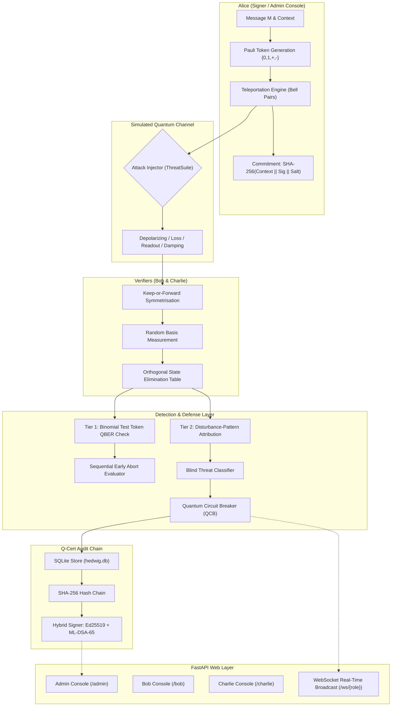

# HEDWIG — Teleportation-Based Quantum Digital Signatures with Cyber Threat Detection

[](https://www.python.org/)
[](https://fastapi.tiangolo.com/)
[](https://qiskit.org/)
[]()
[](LICENSE)

> **Beginner Guide Available:** If you are new to Quantum Digital Signatures or want an intuitive, plain-English breakdown with analogies and viva preparation, see [docs/FOR_DUMMIES.md](docs/FOR_DUMMIES.md).

---

## 🌟 1. Executive Summary & Problem Statement

### The Problem
Classical digital signatures (RSA, ECDSA) rely on computational hardness assumptions (integer factorisation, discrete logarithms) vulnerable to Shor's algorithm on large-scale quantum computers. While Post-Quantum Cryptography (PQC) algorithms (e.g. ML-DSA / Dilithium) introduce lattice-based hardness, they remain computational. 

**Quantum Digital Signatures (QDS)** provide information-theoretic non-repudiation and unforgeability rooted in quantum mechanics:
- **Heisenberg Uncertainty Principle:** Non-commuting observable bases cannot be simultaneously measured without disturbance.
- **No-Cloning Theorem:** Unknown quantum states cannot be copied identically.

However, classical-quantum networked QDS systems face realistic vulnerabilities:
1. Physical and hardware noise (depolarizing, amplitude damping, readout bias, photon loss) mimic malicious tampering.
2. Active quantum adversaries (intercept-resend, optimal quantum cloning, loss exploitation).
3. Protocol and verifier threats (dishonest verifier forgery, sender repudiation, packet replay, impersonation).
4. Cascading denial-of-service from false alarms if quantum links are indiscriminately cut.

### The Solution: HEDWIG V2.2
**HEDWIG** is an interactive, simulated three-party Quantum Digital Signature platform (Alice, Bob, Charlie) equipped with:
- **Simulated Quantum Teleportation:** Bell-state teleportation ($|\Phi^+\rangle$) of random Pauli-eigenstate tokens ($\{|0\rangle, |1\rangle, |+\rangle, |-\rangle\}$) over configurable noisy channels (Qiskit Aer / Statevector simulation).
- **Two-Tier Blind Statistical Threat Detection:** Evidence-driven discrimination of channel noise vs. quantum eavesdropping vs. message tampering without machine learning or prior attack labels.
- **Sequential Early Abort:** Block-by-block channel testing that halts quantum token transmission immediately when error thresholds are decisively crossed, saving quantum resources and link bandwidth.
- **Adaptive Quantum Circuit Breaker (QCB):** Multi-state per-link enforcement engine (`OPEN`, `WATCH`, `QUARANTINED`, `RESET_PENDING`) featuring sequential early abort and Fisher's combined p-value escalation.
- **Tamper-Evident Q-Cert Audit Ledger:** Immutable SHA-256 hash-chained audit ledger dual-signed with classical **Ed25519** and NIST FIPS 204 **ML-DSA-65 (Dilithium)**.
- **Optional extensions:** N-verifier recipient groups (2–10 verifiers, direct or chain delivery; §8.1), multi-hop relay routing with link-aware rerouting and independent edge probes (§8.2), a Python SDK (§14), and an isolated IBM-hardware teleportation benchmark (§11.1).

---

## 🏛️ 2. System Architecture & Component Interaction



### The 5-Phase Protocol Pipeline
1. **Token Generation & Symmetrisation:** Alice creates pairs of Pauli eigenstates for each bit position. Bob and Charlie exchange half their received tokens via random swap gates ("keep-or-forward") so Alice cannot know who holds which token.
2. **Teleportation & Elimination:** States are teleported over simulated Bell channels with feed-forward Pauli corrections. Receivers measure each token in a random basis ($\{Z, X\}$) to eliminate an orthogonal candidate from their verification table.
3. **Commitment Binding:** Alice broadcasts a SHA-256 commitment containing the message digest, recipient list, session nonce, expiration timestamp, and random blinding salt before any states are revealed.
4. **Channel Testing & Sequential Early Abort:** Interleaved secret test tokens evaluate link fidelity block-by-block. If error counts exceed the binomial threshold early, transmission aborts immediately to conserve quantum resources.
5. **Independent Verification & Response:** Bob and Charlie verify received signatures against their elimination tables. Mismatch counts are tested against Hoeffding and exact binomial acceptance thresholds ($s_a$ for direct delivery, $s_v$ for forwarded).

---

## 💻 3. Technology Stack

- **Core Runtime:** Python 3.11+
- **Quantum Simulation:** `qiskit` (2.5.2), `qiskit-aer` (0.17.2), `numpy` (2.3.2)
- **Backend API & Web Server:** `fastapi` (0.115.0), `uvicorn` (0.30.6), `websockets` (16.0), `jinja2` (3.1.6)
- **Classical & Post-Quantum Cryptography:** `cryptography` (48.0.0), `dilithium-py` (1.4.0, NIST FIPS 204 ML-DSA-65)
- **Persistence & Auditing:** SQLite 3 by default (optional PostgreSQL via `HEDWIG_DATABASE_URL`), Ed25519 PEM keys, SoftHSM2 (PKCS#11 token support), JSON-canonical hash chains
- **SDK:** `httpx` (≥ 0.24) for the `hedwig_client` package
- **Deployment & Load Testing:** Docker / Docker Compose, Locust (`locustfile.py`), Render (`render.yaml`, `Procfile`)
- **Testing & Quality Assurance:** `pytest` (protocol, noise, API, routing, N-verifier, SDK and hardware-script suites)
- **Experiments & Benchmarking:** Multiprocessing trial harnesses with seeded RNGs, Wilson score intervals, and ROC curves

---

## 📁 4. Repository Structure & Key Modules

```text
├── server.py                        # FastAPI application, route handlers, WebSocket hub
├── auth.py                          # PBKDF2-SHA256 authentication & role-based sessions
├── users.json                       # Hashed credentials for demo / operational users
├── requirements.txt                 # Core production dependencies
├── requirements-pq.txt              # Optional post-quantum ML-DSA-65 requirements
├── requirements-dev.txt             # Development and testing dependencies
├── run_v2.bat                       # One-click Windows launch script
├── run_experiments.py               # Reproducible experiment runner & manifest generator
├── pyproject.toml                   # hedwig-client SDK packaging
├── Dockerfile, docker-compose.yml   # Container image and App + PostgreSQL 15 bundle
├── locustfile.py                    # Locust load-test scenarios
├── hedwig_client/                   # Python SDK wrapping the REST API (§14)
├── examples/quickstart.py           # SDK demo script
├── docs/                            # CONTEXT.md, FOR_DUMMIES.md, GEMINI.md, PROOF.md, SECURITY_ARGUMENT.md
├── templates/                       # Jinja2 HTML templates
│   ├── login.html                   # Multi-role login interface
│   ├── admin.html                   # Alice sender console, threat injector, circuit reset
│   ├── bob.html                     # Bob verifier terminal & dishonest forward trigger
│   ├── charlie.html                 # Charlie verifier terminal & cross-check audit view
│   └── routing.html                 # Multi-hop routing dashboard
├── static/                          # Styling and client-side logic
│   ├── css/style.css                # Custom vanilla CSS design system
│   ├── js/app.js                    # WebSocket listeners, dynamic DOM updating, charts
│   └── img/icons.svg                # SVG icons and visual assets
├── src/quantum_engine/              # Core simulated quantum cryptography engine
│   ├── __init__.py                  # Public exports and package definition
│   ├── protocol.py                  # Orchestrator: TeleportationQDS main execution
│   ├── teleportation.py             # Qiskit Bell-state teleportation & basis state prep
│   ├── symmetrisation.py            # Keep-or-forward random token swapping
│   ├── elimination.py               # Orthogonal state measurement & elimination tables
│   ├── channel.py                   # Quantum channel models (depolarizing, readout, loss, damping)
│   ├── threats.py                   # 11 attack scenario injectors (ThreatSuite)
│   ├── detection.py                 # QDSDetectionEngine & ThreatReport classification
│   ├── discriminator.py             # Tier 2 disturbance-pattern attribution
│   ├── policy.py                    # ResponsePolicy & Fisher's combined p-value escalation
│   ├── enforcement.py               # ChannelGuard & Quantum Circuit Breaker (QCB)
│   ├── binding.py                   # SignedContext & cryptographic commitment validation
│   ├── verifier.py                  # VerifierNode & Hoeffding/exact threshold checks
│   ├── cloning.py                   # Quantum cloner models (universal & phase-covariant)
│   ├── audit.py                     # Q-Cert ledger, hash chains, and certificate generation
│   ├── signers.py                   # Ed25519 and ML-DSA-65 post-quantum signing logic
│   ├── store.py                     # SQLite persistence for sessions, transitions & audits
│   ├── router.py                    # Simulated quantum network routing and link state
│   ├── topology.py                  # Validated, immutable directed topologies (legacy star / multi-hop)
│   ├── routing.py                   # Bounded deterministic route allocation before preparation
│   ├── multihop.py                  # Per-hop channels and traversal records
│   ├── monitoring.py                # Independent edge probes & monitored recovery
│   ├── roster.py, ledger.py         # N-verifier session config and verification-event ledger
│   ├── key_provider.py              # Software / SoftHSM2 (PKCS#11) audit keys
│   ├── schedule.py                  # Measurement basis scheduling
│   ├── thresholds.py                # Exact binomial limits & reserve stage planning
│   └── security.py                  # Theoretical security parameters and bound models
├── tests/                           # pytest suites: protocol, noise, API, ablations, routing, N-verifier, SDK, hardware
└── experiments/                     # Scientific evaluation harness, sweeps, ROC & ablation scripts
    ├── hardware/                    # IBM QPU 3-qubit teleportation benchmark (§11.1)
    ├── routing_eval.py              # Primary vs failover routing trials
    ├── n_verifier_eval.py           # N-verifier evaluation
    ├── harness.py                   # Resumable grid harness (seed x scenario x L x noise)
    ├── make_roc.py                  # ROC curve generation with seeded bootstrap AUC intervals
    ├── ablate_early_abort.py        # Sequential early abort evaluation & bandwidth savings
    ├── ablate_tiers.py              # Tier 1 vs Tier 1+2 attribution ablation study
    ├── ablate_escalation.py         # Fisher combined p-value vs k-alert counter ablation
    ├── ablate_adaptive.py           # Fixed vs adaptive test token allocation
    ├── baselines.py                 # Benchmarking against 11% QBER cutoff & no-breaker baseline
    └── sweep_*.py                   # Physical sweeps (damping, readout, loss, tiers)
```

---

## ⚡ 5. Installation & Setup

### 5.1 Prerequisites
- **Operating System:** Windows, Linux, or macOS
- **Python:** 3.11 or higher installed and added to `PATH`

### 5.2 Step-by-Step Installation

1. **Clone the repository:**
   ```bash
   git clone https://github.com/miki-dev-5618/QDS.git
   cd QDS
   ```

2. **Create and activate a virtual environment:**
   - *Windows (PowerShell):*
     ```powershell
     python -m venv .venv
     .\.venv\Scripts\Activate.ps1
     ```
   - *Linux / macOS:*
     ```bash
     python3 -m venv .venv
     source .venv/bin/activate
     ```

3. **Install Dependencies:**
   - Core dependencies:
     ```bash
     pip install -r requirements.txt
     ```
   - Post-quantum ML-DSA-65 signatures (recommended):
     ```bash
     pip install -r requirements-pq.txt
     ```
   - Development & test dependencies:
     ```bash
     pip install -r requirements-dev.txt
```
   - *(Optional) SoftHSM2 / PKCS#11 token dependencies:*
     ```bash
     pip install -r requirements-hsm.txt
     ```

4. **Run the Application:**
   ```bash
   python server.py
   ```
   Or on Windows:
   ```cmd
   run_v2.bat
   ```
   Open your browser to: **`http://localhost:8000`**

### 5.3 Docker (Optional)

**Build & run (single container, SQLite):**
```bash
docker build -t hedwig .                                   # add --build-arg INSTALL_PQ=false to skip dilithium-py
docker run -p 8000:8000 -v hedwig_data:/app/data hedwig
```

**Compose (App + PostgreSQL 15):**
```bash
docker compose up --build                                  # http://localhost:8000
```

| Item | Value |
| :--- | :--- |
| Base image | `python:3.11-slim` (`runtime.txt`: `python-3.11.10`) |
| Start command | `uvicorn server:app --host 0.0.0.0 --port ${PORT:-8000}`: one process, one worker |
| Port | `8000` (`EXPOSE 8000`, `PORT=8000`); compose host port `HEDWIG_PORT` (default 8000) |
| Healthcheck | `GET /health` every 30 s (unauthenticated) |
| Volumes | `/app/data` holds `hedwig.db` and `audit_ed25519.pem` (compose: `appdata`); compose `pgdata` holds Postgres data |
| Compose env | `HEDWIG_DATABASE_URL` (Postgres; remove it to use SQLite), `HEDWIG_BACKEND` (default `qiskit`), `HEDWIG_POSTGRES_PASSWORD` (default `hedwig`), `HEDWIG_DB_PORT` (default 5432) |
| Build arg | `INSTALL_PQ=true` installs `requirements-pq.txt`; `requirements-hsm.txt` is **not** installed |

**Security notes**
- Runs as non-root `hedwig` (uid/gid 10001); only `/app/data` is writable.
- `.dockerignore` keeps `data/`, `.env`, `.git`, `tests/`, `experiments/results/` and `*.md` out of the image, so the `/results` page is empty inside the container.
- **Keep `/app/data` on a volume.** The audit key must persist (otherwise old certificates verify only against a lost key) and must never be committed or baked into an image.
- Compose is a **local demo**: weak default DB password, Postgres published on the host, and demo logins unless you mount a users file and set `HEDWIG_USERS_FILE`.
- Do not scale to multiple workers or replicas: the engine, sessions and circuit-breaker guards are in-process.

**Other deploy targets:** `Procfile` (`web: uvicorn server:app --host 0.0.0.0 --port $PORT`). `render.yaml` is currently empty.

### 5.4 Hardware Security Module / SoftHSM2 (Optional)
By default (`HEDWIG_KEY_PROVIDER=software`), Ed25519 and ML-DSA-65 keys reside in `data/`. For PKCS#11 hardware token or software emulator (SoftHSM2) signing:
1. Initialize a token: `softhsm2-util --init-token --free --label hedwig`
2. Run with environment variables set:
   ```bash
   export HEDWIG_KEY_PROVIDER=softhsm
   export HEDWIG_PKCS11_LIB=/path/to/libsofthsm2.so   # on Windows: softhsm2.dll
   export HEDWIG_PKCS11_TOKEN=hedwig
   export HEDWIG_PKCS11_PIN=<your_token_pin>
   python server.py
   ```
3. Key rotation is supported via `POST /api/audit/rotate-key` or `AuditAuthority.rotate()`. Retired public keys remain verifiable via `GET /api/audit-public-key`.

---

## 🔑 6. Authentication & Roles

HEDWIG isolates signer, verifier, and monitoring functions using role-based sessions stored in HttpOnly, SameSite=Strict cookies (`hedwig_admin`, `hedwig_bob`, `hedwig_charlie`).

| Username | Password | Role | Access Route | Functional Scope |
| :--- | :--- | :--- | :--- | :--- |
| `admin` / `alice` | `admin2026` / `quantum2026` | `admin` | `/admin` | State preparation, signing, threat injection, circuit breaker resets, full ground-truth audit |
| `bob` | `quantum2026` | `bob` | `/bob` | Verifier 1 inspection, elimination records, dishonest forward attack trigger |
| `charlie` | `quantum2026` | `charlie` | `/charlie` | Verifier 2 inspection, forwarded signature reception, cross-verification |

*To provision custom users:*
```bash
python auth.py add-user users.json newuser admin
```
Set the environment variable: `HEDWIG_USERS_FILE=users.json`.

---

## 🛡️ 7. Threat Catalog & Detection Mechanics

`ThreatType` in `src/quantum_engine/threats.py` defines **17 scenarios**: the `authentic` baseline, **11 core attacks** (table below) and **5 N-verifier forwarding attacks** (§8.1). Multi-hop routing (§8.2) has no scenario of its own; `eve_intercept` can target a single quantum edge via `attack_edge`, and admins can inject edge faults through `/api/routing/fault`.

| Threat Type | Mechanism | Detection Layer | Action |
| :--- | :--- | :--- | :--- |
| `authentic` | Normal transmission over noisy channel | Acceptance | `OPEN` |
| `eve_forgery` | Eve manufactures random tokens without Alice's keys | Elimination Table (~25% contradictions) | `QUARANTINED` |
| `dishonest_bob` | Bob alters signature bits and forwards to Charlie | Forward Elimination Check ($s_v$ threshold) | `QUARANTINED` |
| `eve_intercept` | Intercept-resend measuring in random Pauli bases | Tier 1 Channel Test QBER (Eavesdropping) | `QUARANTINED` |
| `message_tampering`| Eve modifies plaintext $M \to M'$ in flight | Classical Commitment & SHA-256 Digest Mismatch | Link stays `OPEN` (Prevents DoS) |
| `repudiation` | Alice signs, but selectively flips revealed tokens | Tier 2 Attribution (Disturbance vs Signature mismatch) | `QUARANTINED` |
| `replay` | Replaying previously captured valid transmission | Context Nonce & Timestamp Verification | Link stays `OPEN` (Prevents DoS) |
| `impersonation` | Claiming Alice's identity without valid distribution | Sender Identity & Distribution Record Check | Link stays `OPEN` (Prevents DoS) |
| `eve_loss_exploit` | Eve blocks disturbed tokens simulating photon loss | Readout / Channel Loss Anomaly Detector | `WATCH` / `QUARANTINED` |
| `eve_cloning` | Eve uses optimal quantum cloner (Universal / Phase) | Cloner fidelity bound violation | `QUARANTINED` |
| `eve_partial_intercept`| Eve intercepts only a fraction of tokens ($5\%$) | Sequential Early Abort / Fisher's Escalation | `WATCH` $\to$ `QUARANTINED` |
| `eve_collective` | Eve couples an ancilla to every token with the same controlled-Ry($\theta$) and measures the ancillas after basis announcement. **One concrete collective attack, not a proof against collective attacks in general.** | Dephasing of X-basis tokens raises test-token QBER (Tier 1). At $\theta=\pi/2$: Eve guesses 67.7% of bits, verifier mismatch 3.8%, detected in 59-65% of transmissions (`experiments/sweep_collective.py`) | `WATCH` / `QUARANTINED` when detected |

---

## ⚙️ 8. Configuration & Environment Variables

| Variable | Default | Options | Description |
| :--- | :--- | :--- | :--- |
| `PORT` | `8000` | Integer | HTTP web server port |
| `HOST` | `0.0.0.0` | IP string | Bind host address (`python server.py` only; Docker/Procfile hard-code `0.0.0.0`) |
| `HEDWIG_BACKEND` | `qiskit` | `qiskit`, `statevector` | Quantum simulation engine |
| `HEDWIG_DB` | `data/hedwig.db` | Path | SQLite persistent database path |
| `HEDWIG_DATABASE_URL` | None | `postgresql://…` | Use PostgreSQL instead of SQLite (set by `docker-compose.yml`) |
| `HEDWIG_TOPOLOGY` | `legacy-star/1` | `demo-multihop` | Topology selected at startup (a persisted activation is otherwise restored) |
| `HEDWIG_AUDIT_KEY` | `data/audit_ed25519.pem` | Path | Ed25519 audit authority private key path |
| `HEDWIG_AUDIT_PQ` | `auto` | `auto`, `require`, `off` | Enforce ML-DSA-65 post-quantum dual signing |
| `HEDWIG_KEY_PROVIDER` | `software` | `software`, `softhsm` | Audit key provider backend (file vs. PKCS#11 SoftHSM2) |
| `HEDWIG_PKCS11_LIB` | None | Path | Dynamic library path to PKCS#11 module (.dll / .so) |
| `HEDWIG_PKCS11_TOKEN`| `hedwig` | String | Token label for SoftHSM2 PKCS#11 token |
| `HEDWIG_PKCS11_PIN`  | None | String | User PIN for SoftHSM2 PKCS#11 token |
| `HEDWIG_USERS_FILE` | None | Path to JSON | PBKDF2 hashed credentials file path |
| `EARLY_ABORT` | `on` | `on`, `off`, `true`, `false` | Enable/disable sequential early abort |
| `DETECTION_TIERS` | `2` | `1`, `2` | Detection tier depth (ablation toggle) |
| `ESCALATION` | `fisher` | `fisher`, `fisher_only`, `counter` | Circuit-breaker escalation rule |
| `HEDWIG_NOISE_PROFILE` | None | `ibm_fake`, `lossy` | Force a default channel profile |

### 8.1 Optional N-verifier extension (recipient scaling)

Full design notes: [N_VERIFIER_EXTENSION.md](N_VERIFIER_EXTENSION.md).

One signer (Alice) can serve a fixed group of **2 to 10 pre-enrolled verifiers**. The default is unchanged: Alice with Bob and Charlie, direct delivery, one re-forward hop. The extension lets more recipients independently authenticate the same signed message, including through a bounded forwarding chain. Example: headquarters issues an instruction and each regional office checks it before acting. It is an optional add-on; the project's focus remains threat detection.

| Setting | Values | Notes |
| :--- | :--- | :--- |
| Roster (N) | 2–10 enrolled identities (`bob, charlie, dave, erin, frank, grace, heidi, ivan, judy, kim`) | Fixed before distribution and bound into the signer's commitment (`SignedContext.verifiers`) |
| Delivery | `direct` (Alice reveals to everyone) or `chain` (Alice reveals to the first member; each member that accepts forwards the unchanged package to the next) | Forwarding is classical package transfer, not new quantum evidence |
| Max depth (H) | `direct`: 1. `chain`: 1 … N − 1 | Members beyond depth H are reported as `outside_depth` |

**Behaviour**

- **Distribution.** Alice prepares one copy of each signature position per roster member. With N > 2, each copy is reassigned privately to a holder chosen uniformly at random (*uniform final holder*). For N = 2 the original keep-or-forward rule is kept; it has the same holder probabilities. Every member receives its evidence before the reveal; nothing is created after the reveal.
- **Depth-aware decisions (exact policy).** Depth 0 uses the direct limit k_fr and depth H the forwarded limit k_fa. Levels in between are evenly spaced whole numbers in [k_fr, k_fa] that never decrease with depth, so every level meets both risk targets whenever the endpoints do. With H = 1 the rules are exactly the original direct/forwarded pair. When there is too little evidence to support distinct limits, levels share a limit (see the table below); no thresholds are invented. The legacy schedule s_l = μ_h + (l+1)(p_min − μ_h)/(H+2) is available only under `threshold_policy="legacy"` and is labelled experimental.
- **Transfer integrity.** Each recipient works out the applicable depth from its own distribution record and the authenticated sender, never from the package. An unknown forwarder, an edge not on the route, a wrong claimed depth, or a missing or substituted parent event makes the transfer invalid. An invalid transfer is evaluated under the strictest (depth 0) rule and rejected as `INVALID_TRANSFER`, a classical rejection that does not lock the link.
- **Duplicates and the reserve.** Each verifier evaluates at most one forwarded delivery per session, from any sender or route. The reserve is opened at most `max_reserve_openings` times per session across all channels. If Alice cannot open it, the result stays inconclusive.
- **Stop rule.** Normal forwarding stops at a rejection or an inconclusive result. Recipients after that point are `not_reached`, which is not the same as rejected.
- **Session outcome.** `all_accepted` only if every required recipient accepted (there is no majority rule). Otherwise `rejected`, `inconclusive`, `incomplete` or `distribution_aborted`.

**Additional scenarios.** In each, one selected verifier is dishonest; collusion is not modelled.

| Scenario | Mechanism | Observed result |
| :--- | :--- | :--- |
| `dishonest_forwarder` | Receives the genuine package, then alters the message or signature and forwards it | The next honest recipient rejects: digest mismatch (message) or commitment mismatch (signature). Classified as `DISHONEST_VERIFIER_FORGERY` |
| `forward_withheld` (chain) | Accepts but never forwards | Downstream members are `not_reached`; session `incomplete`; no forgery alleged |
| `route_manipulation` (chain) | Forwards the genuine package claiming a deeper level | Refused at depth 0 → `INVALID_TRANSFER` |
| `forward_replay` | The same package reaches a recipient again (from another sender in direct mode) | Refused as a duplicate without opening the reserve → `REPLAY_ATTACK` |
| `unknown_forwarder` | An identity that is not enrolled forwards the genuine package | `INVALID_TRANSFER` |

**Records.** Every verification is a ledger event with a unique id, its session, its sender, its depth and its parent event. Events are persisted in SQLite (`sessions` and `verification_events` tables) and are never keyed by verifier + mode, so repeated events do not overwrite each other. New audit records use `hedwig-audit/3`:
- The transaction record binds the roster, delivery mode, H and the reveal events.
- Each chain forwarding event is its own immutable `transfer` record, naming its parent event and the artifact id and payload hash of the record that holds it.
- `hedwig-audit/2` certificates still verify under their original rules.

The one-time quantum evidence is still not persisted, so after a restart a pending session must be redistributed.

**Interface.** Admin console → *Recipient group*: N, delivery, H, dishonest forwarder and alteration. A *Recipient matrix* shows one row per participant with its durable event history (`GET /api/sessions/{id}/events`). The Bob and Charlie terminals are unchanged. They never see extra recipients, the other verifier's private evidence, or symmetrisation decisions.

**Limitations (stated, not solved)**

- Adding recipients does **not** add security. It is not universal (public) verification, and it is not group approval, multiple signers or threshold signing.
- Security against collusion between recipients is not claimed. Per-event risks are reported; **no session-level aggregate bound** is claimed, because all recipients' evidence comes from one distribution and is not independent.
- A rejection does not by itself show which participant caused it.
- The transfer margin only appears with enough evidence. With about L checked copies per verifier, the depth limits stay equal up to L ≈ 64 and separate around L ≈ 128. The dashboard caps L at 64, so in the UI all depths currently show the same limit.
- Isolation acts on the two logical links: signer distribution, and verifier transfers pooled together. Per-edge hop counters show traffic but are not used to attribute blame to an edge.
- Distribution cost grows linearly with N (one copy per recipient per position). See `experiments/n_verifier_eval.md`.
- Published multiparty QDS work (e.g. arXiv:1505.07509) is a reference for this analysis, not a proof that applies to this codebase.

### 8.2 Optional multi-hop routing & link-aware rerouting

Full design notes: [MULTI_HOP_ROUTING_IMPLEMENTATION.md](MULTI_HOP_ROUTING_IMPLEMENTATION.md).

- **Topologies.** The default is the backward-compatible `legacy-star/1` (Alice → QR-1 → verifiers). Admins can activate the bundled `demo-multihop` preset (Alice → R1 → R2 → recipients, with an R3 bypass) or upload a validated topology JSON; it applies to future sessions only.
- **Routing.** Routes are allocated deterministically for the whole roster before any tokens are prepared. Blocked edges are pruned, and preference goes OPEN > probation > explicitly permitted WATCH, then monitoring freshness, cost and edge ID. If no route exists, the send returns HTTP 423 listing affected recipients and rejected candidates.
- **Per-hop teleportation.** Each hop consumes a fresh Bell pair with Bell measurement and Pauli correction; only the destination measures. Heralded loss ends a token at that hop.
- **Edge monitoring.** Independent probes (64–4096 fresh test tokens per edge) attribute faults to individual edges; end-to-end observations only restrict whole paths. Recovery after reset needs ≥ 1024 surviving probe tests over ≥ 2 rounds.
- **Records.** Topology, route plan and execution are bound into signed audit commitments. Participants see only their own route.
- **Limits.** Run with **one Uvicorn worker** (live guards are process-local). Relays are assumed honest and classical channels authenticated. IBM fake-backend calibration works only for the legacy star.

---

## 📡 9. REST API & WebSocket Endpoints

| Endpoint | Method | Role | Description |
| :--- | :--- | :--- | :--- |
| `/api/login` | `POST` | Public | Authenticates credentials and sets role session cookie |
| `/api/logout?role=` | `POST` | Public | Revokes that role's session token and deletes its cookie |
| `/api/sign-and-send` | `POST` | `admin` | Executes token prep, teleportation, commitment, and verification (400 bad config, 409 replay preamble rejected, 422 bad noise profile, 423 quarantined) |
| `/api/noise-profiles` | `GET` | Authenticated | Noise profile catalogue and default channel |
| `/api/arm-threat` | `POST` | `admin` | Sets active threat for the UI |
| `/api/verification/{tx_id}/{verifier}` | `GET` | That verifier | A verifier's own result |
| `/api/dishonest-bob-forward` | `POST` | `bob` | Triggers dishonest Bob forwarding attack to Charlie |
| `/api/channel/reset` | `POST` | `admin` | Resets quarantined link to probation (Requires reason) |
| `/api/channel` | `GET` | Authenticated | Returns current Quantum Circuit Breaker status |
| `/api/topology` | `GET` | Authenticated | Topology, edge states, monitoring freshness (router detail admin-only) |
| `/api/history` | `GET` | Authenticated | Last 50 transmissions (role-filtered; no ground truth for verifiers) |
| `/api/audit/{artifact_id}` | `GET` | Authenticated | Signed Q-Cert JSON (evidence only for admin; routing/fault records admin-only) |
| `/api/incidents` | `GET` | Authenticated | Last 50 incident certificates |
| `/api/audit/chain` | `GET` | `admin` | Retrieves entire SHA-256 hash chain and validation report |
| `/api/audit-public-key` | `GET` | Public | Keyring endpoint with active and retired public keys |
| `/api/audit/verify` | `POST` | Public | Independent verification of supplied Q-Cert certificate |
| `/api/metrics` | `GET` | `admin` | Telemetry, latency statistics, and error counters |
| `/api/roster` | `GET` | `admin` | Enrolled verifier identities and N-verifier limits |
| `/api/sessions/{id}/events` | `GET` | `admin` | Durable roster and verification-event history |
| `/api/topology` | `POST` | `admin` | Activate `demo-multihop` preset or a custom topology |
| `/api/routing/history`, `/api/sessions/{id}/routes` | `GET` | Authorized | Stored route plans and execution (recipient-filtered) |
| `/api/routing/refusals` | `GET` | `admin` | Persisted routing preflight refusals |
| `/api/routing/fault` | `POST` | `admin` | Inject/clear an edge attack or set manual WATCH/QUARANTINED |
| `/api/routing/probe` | `POST` | `admin` | Independent edge probe |
| `/api/routing/emergency` | `POST` | `admin` | Toggle emergency stop |
| `/api/routing/preview` | `POST` | `admin` | Preview route allocation for a roster |
| `/api/routing/demo` | `POST` | `admin` | Run the signed failover self-test |
| `/admin/routing` | `GET` | `admin` | Routing dashboard page |
| `/health` | `GET` | Public | Liveness check |
| `/results` | `GET` | Authenticated | Experiment results page (ROC, ablations, baselines, tightness, hardware, manifest) read from `experiments/results/` |
| `/ws/{role}` | `WebSocket` | Role-Specific | Full-duplex WebSocket stream for real-time console updates |

---

## 🧪 10. Automated Testing & Verification

The repository contains an extensive automated test suite executed with `pytest`:

```bash
# Run all tests
pytest -v

# Run fast execution without verbose logging
pytest -q
```

**Key Test Coverage:**
- `test_teleportation.py`: Bell-pair teleportation fidelity and feed-forward Pauli operations.
- `test_cloning.py`: Universal and phase-covariant cloner fidelity bounds.
- `test_detector_blind.py`: Blind threat detection without ground-truth labels.
- `test_enforcement_audit.py`: Circuit breaker state machine and Q-Cert hash chain.
- `test_noise_readout.py`, `test_loss.py`, `test_noise_damping.py`: Quantum channel noise models.
- `test_partial_intercept.py`: Opt-in partial intercept-resend attack dynamics.
- `test_ablations.py`: Toggles and metrics for sequential early abort and 1-tier vs 2-tier detection.
- `test_harness.py`: Resumable grid experiment runner and RNG determinism.
- `test_make_roc.py`: Verifier mismatch ROC generation and AUC interval estimation.
- `test_api.py`: FastAPI endpoints, cookie validation, and role enforcement.
- `test_n_verifier.py`: N-verifier configuration, chain delivery, forwarding attacks, transfer records.
- `test_multihop_routing.py`, `test_routing_api.py`: Topology validation, rerouting, probes, recovery, route audit tampering, routing API authorization.
- `test_ibm_hardware.py`: Hardware benchmark scripts on the local simulator (no token or QPU time).
- `test_sdk.py`: `hedwig_client` SDK via `httpx.MockTransport`.

---

## 🔬 11. Scientific Reproducibility & Experiments

Every experiment result, table, and ROC curve can be reproduced with a single command:

```bash
python run_experiments.py --seed 2026            # full run, tens of minutes
python run_experiments.py --quick                # smoke test: every step at tiny trial counts (~10 s)
python run_experiments.py --seed 2026 --resume   # skip steps already finished with identical settings
```

Outputs are saved under `experiments/results/`:
- `raw.jsonl`: Raw per-trial execution records.
- `summary.csv`: Aggregated detection and false-alarm rates with 95% Wilson confidence intervals.
- `manifest.json`: System provenance, git commit, packages, seed, and per-step execution timing.
- `PPT_NUMBERS.md`: Verified numerical claims mapped to their origin data files.

Extension evaluations: `python experiments/n_verifier_eval.py --trials 40 --seed 2026` and `python experiments/routing_eval.py --trials 10 --seed 2026 --output experiments/routing_results.json`. The checked-in routing sample is a 3-trial functional smoke test, not a production rate.

### 11.1 IBM Hardware Teleportation Benchmark (optional)

`experiments/hardware/` runs **only** the isolated 3-qubit deferred-measurement teleportation circuit for `|0>`, `|1>`, `|+>`, `|->` on IBM QPUs. **The full QDS protocol is not run on hardware.**

```bash
pip install -r experiments/hardware/requirements-hardware.txt
export IBM_QUANTUM_TOKEN='<your-token>'                               # env only, never hardcoded
python experiments/hardware/run_ibm_teleport.py --dry-run --shots 2000  # local Aer, no token
python experiments/hardware/run_ibm_teleport.py --shots 2000            # real QPU
python experiments/hardware/compare_hw_vs_sim.py experiments/hardware/result_<timestamp>.json
```

See [experiments/hardware/README.md](experiments/hardware/README.md) for job recovery (`--job-id`), the result schema and the claim template.

---

## ⚠️ 12. Limitations & Simulation Scope

In strict adherence to academic and engineering integrity:
1. **Simulation Platform:** This software is a **classical numerical and circuit simulation** using Qiskit Aer and NumPy statevectors. It executes on classical CPUs and **does not provide physical quantum hardware security**.
2. **Channel Assumptions:** Quantum channels, fiber loss, and detector clicks are modeled using statistical noise models (depolarizing, amplitude damping, asymmetric readout error).
3. **Post-Quantum Reference Implementation:** `dilithium-py` provides a pure-Python reference implementation of ML-DSA-65 suitable for demonstration; it is not side-channel hardened for production environments.
4. **Computational Binding:** The commitment scheme relies on the computational preimage and collision resistance of SHA-256.
5. **Single Process:** Live circuit-breaker guards and one-time quantum evidence are process-local; run one Uvicorn worker. Pending sessions must be redistributed after a restart.
6. **Extensions are not security upgrades:** More recipients or relay hops do not add security; collusion and malicious relays are not modelled.

---

## 👥 13. Team & Attribution

Developed by **Team ATHENA** for **Smart India Hackathon (SIH) 2026** and **QHack**.  
For complete beginner guidance, analogies, and viva preparation, read [docs/FOR_DUMMIES.md](docs/FOR_DUMMIES.md).

---

## 🐍 14. Python SDK — `hedwig-client` (Feature E55)

The `hedwig_client/` package (`hedwig-client` 0.1.0, Python ≥ 3.11, depends only on `httpx>=0.24.0`) is a **synchronous** client that drives the server from scripts or notebooks. The server stays the source of truth: the SDK uses normal role cookies and receives the same role-filtered responses (no `ground_truth` unless logged in as admin).

```bash
pip install -e .           # SDK only
pip install -e ".[dev]"    # + pytest, pytest-asyncio, fastapi[standard]
```

Use real credentials (demo admin: `admin` / `admin2026`). `sign_and_send` and `reset_link` need the **admin** role. `scenario` takes `ThreatType` values (e.g. `eve_intercept`, `eve_cloning`, `replay`); `L` maps to `n_bits` (server clamps it to 8–64; SDK default 16, server default 32). There is no WebSocket or async support.

### Quick Start

```python
from hedwig_client import HedwigClient, LinkQuarantinedError

with HedwigClient("http://localhost:8000", "admin", "admin2026") as client:
    client.login()
    print(client.topology()["channel_state"])

    try:
        result = client.sign_and_send("Transfer £1 000 to account #42")
        print(f"verdict={result.verdict}  qber={result.qber:.4f}")
    except LinkQuarantinedError as exc:
        print("Link quarantined —", exc.detail["link"])
        client.reset_link(reason="SDK recovery")
```

### Methods

| Method | Endpoint | Notes |
|--------|----------|-------|
| `login()` | `POST /api/login` | Stores session cookie automatically |
| `sign_and_send(message, L=16, scenario="authentic", noise_profile=None)` | `POST /api/sign-and-send` | `noise_profile` is a dict merged into the request body (e.g. `{"noise_profile": "readout", "readout_p01": 0.02}`); returns `TransmissionResult` (`.raw` keeps the full payload) |
| `get_audit(artifact_id)` | `GET /api/audit/{id}` | Returns `AuditCertificate` |
| `reset_link(reason)` | `POST /api/channel/reset` | Returns raw server dict |
| `topology()` | `GET /api/topology` | Returns raw server dict |

### Exception Hierarchy

```
HedwigError
├── AuthError          (HTTP 401 / 403)
├── LinkQuarantinedError  (HTTP 423 — link/route quarantined; full server body in .detail)
└── APIError           (all other HTTP errors)
```

Not wrapped by the SDK (use `client.session`, an `httpx.Client`, directly): logout, history, channel, audit chain/verify/keys, metrics, N-verifier and routing endpoints, dishonest-Bob forward.

### Running the Tests

```powershell
pytest tests/test_sdk.py -v   # 16 tests using httpx.MockTransport — no server needed
```
