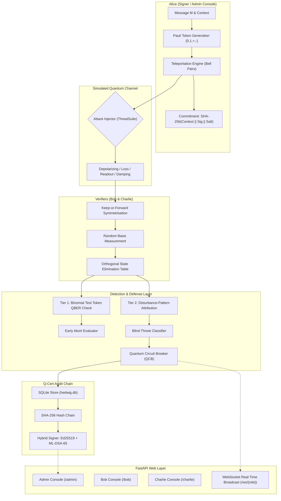

# HEDWIG — Teleportation-Based Quantum Digital Signatures with Cyber Threat Detection

[](https://www.python.org/)
[](https://fastapi.tiangolo.com/)
[](https://qiskit.org/)
[]()
[]()

> **Beginner Guide Available:** If you are new to Quantum Digital Signatures or want an intuitive, plain-English breakdown with analogies and viva preparation, see [FOR_DUMMIES.md](FOR_DUMMIES.md).

---

## 🌟 1. Executive Summary & Problem Statement

### The Problem
Classical digital signatures (RSA, ECDSA) rely on computational hardness assumptions (integer factorisation, discrete logarithms) vulnerable to Shor's algorithm on large-scale quantum computers. While Post-Quantum Cryptography (PQC) algorithms (e.g. ML-DSA / Dilithium) introduce lattice-based hardness, they remain computational. 

**Quantum Digital Signatures (QDS)** provide information-theoretic non-repudiation and unforgeability rooted in quantum mechanics:
- **Heisenberg Uncertainty Principle:** Non-commuting observable bases cannot be simultaneously measured without uncertainty.
- **No-Cloning Theorem:** Unknown quantum states cannot be copied identically.

However, classical-quantum networked QDS systems face realistic vulnerabilities:
1. Physical and hardware noise (depolarizing, amplitude damping, readout bias, photon loss) mimic malicious tampering.
2. Active quantum adversaries (intercept-resend, optimal quantum cloning, loss exploitation).
3. Protocol and verifier threats (dishonest verifier forgery, sender repudiation, packet replay, impersonation).
4. Cascading denial-of-service from false alarms if quantum links are indiscriminately cut.

### The Solution: HEDWIG V2.2
**HEDWIG** is an interactive, simulated three-party Quantum Digital Signature platform (Alice, Bob, Charlie) equipped with:
- **Simulated Quantum Teleportation:** Bell-state teleportation ($|\Phi^+\rangle$) of random Pauli-eigenstate tokens ($\{|0\rangle, |1\rangle, |+\rangle, |-\rangle\}$) over configurable noisy channels (Qiskit Aer / Statevector simulation).
- **Two-Tier Blind Statistical Threat Detection:** Evidence-driven discrimination of channel noise vs. quantum eavesdropping vs. message tampering without machine learning or prior attack labels.
- **Adaptive Quantum Circuit Breaker (QCB):** Multi-state per-link enforcement engine (`OPEN`, `WATCH`, `QUARANTINED`, `RESET_PENDING`) featuring sequential early abort and Fisher's combined p-value escalation.
- **Tamper-Evident Q-Cert Audit Ledger:** Immutable SHA-256 hash-chained audit ledger dual-signed with classical **Ed25519** and NIST FIPS 204 **ML-DSA-65 (Dilithium)**.

---

## 🏛️ 2. System Architecture & Component Interaction



### The 5-Phase Protocol Pipeline
1. **Token Generation & Symmetrisation:** Alice creates pairs of Pauli eigenstates for each bit position. Bob and Charlie exchange half their received tokens via random swap gates ("keep-or-forward") so Alice cannot know who holds which token.
2. **Teleportation & Elimination:** States are teleported over simulated Bell channels with feed-forward Pauli corrections. Receivers measure each token in a random basis ($\{Z, X\}$) to eliminate an orthogonal candidate from their verification table.
3. **Commitment Binding:** Alice broadcasts a SHA-256 commitment containing the message digest, recipient list, session nonce, expiration timestamp, and random blinding salt before any states are revealed.
4. **Channel Testing & Sequential Early Abort:** Interleaved secret test tokens evaluate link fidelity block-by-block. If error counts exceed the binomial threshold early, transmission aborts immediately to conserve quantum resources.
5. **Independent Verification & Response:** Bob and Charlie verify received signatures against their elimination tables. Mismatch counts are tested against Hoeffding acceptance thresholds ($s_a$ for direct delivery, $s_v$ for forwarded).

---

## 💻 3. Technology Stack

- **Core Runtime:** Python 3.11+
- **Quantum Simulation:** `qiskit` (2.5.2), `qiskit-aer` (0.17.2), `numpy` (2.3.2)
- **Backend API & Web Server:** `fastapi` (0.115.0), `uvicorn` (0.30.6), `websockets` (16.0), `jinja2` (3.1.6)
- **Classical & Post-Quantum Cryptography:** `cryptography` (48.0.0), `dilithium-py` (1.4.0, NIST FIPS 204 ML-DSA-65)
- **Persistence & Auditing:** SQLite 3 (`sqlite3` standard library), Ed25519 PEM keys, JSON-canonical hash chains
- **Testing & Quality Assurance:** `pytest` (217 automated tests passing)

---

## 📁 4. Repository Structure & Key Modules

```text
├── server.py                        # FastAPI application, route handlers, WebSocket hub
├── auth.py                          # PBKDF2-SHA256 authentication & role-based sessions
├── users.json                       # Hashed credentials for demo / operational users
├── requirements.txt                 # Core production dependencies
├── requirements-pq.txt              # Optional post-quantum ML-DSA-65 requirements
├── requirements-dev.txt             # Development and testing dependencies
├── run_v2.bat                       # One-click Windows launch script
├── templates/                       # Jinja2 HTML templates
│   ├── login.html                   # Multi-role login interface
│   ├── admin.html                   # Alice sender console, threat injector, circuit reset
│   ├── bob.html                     # Bob verifier terminal & dishonest forward trigger
│   └── charlie.html                 # Charlie verifier terminal & cross-check audit view
├── static/                          # Styling and client-side logic
│   ├── css/                         # Custom vanilla CSS design system
│   ├── js/                          # WebSocket listeners, dynamic DOM updating, charts
│   └── img/                         # SVG icons and visual assets
├── src/quantum_engine/              # Core simulated quantum cryptography engine
│   ├── __init__.py                  # Public exports and package definition
│   ├── protocol.py                  # Orchestrator: TeleportationQDS main execution
│   ├── teleportation.py             # Qiskit Bell-state teleportation & basis state prep
│   ├── symmetrisation.py            # Keep-or-forward random token swapping
│   ├── elimination.py               # Orthogonal state measurement & elimination tables
│   ├── channel.py                   # Quantum channel models (depolarizing, readout, loss, damping)
│   ├── threats.py                   # 11 attack scenario injectors (ThreatSuite)
│   ├── detection.py                 # QDSDetectionEngine & ThreatReport classification
│   ├── discriminator.py             # Tier 2 disturbance-pattern attribution
│   ├── policy.py                    # ResponsePolicy & Fisher's combined p-value escalation
│   ├── enforcement.py               # ChannelGuard & Quantum Circuit Breaker (QCB)
│   ├── binding.py                   # SignedContext & cryptographic commitment validation
│   ├── verifier.py                  # VerifierNode & Hoeffding threshold checks
│   ├── cloning.py                   # Quantum cloner models (universal & phase-covariant)
│   ├── audit.py                     # Q-Cert ledger, hash chains, and certificate generation
│   ├── signers.py                   # Ed25519 and ML-DSA-65 post-quantum signing logic
│   ├── store.py                     # SQLite persistence for sessions, transitions & audits
│   ├── router.py                    # Simulated quantum network routing and link state
│   ├── schedule.py                  # Measurement basis scheduling
│   └── security.py                  # Theoretical security parameters and bound models
├── tests/                           # 16 test files (217 total test cases)
└── experiments/                     # Benchmark scripts, calibration suites, and trial runners
```

---

## ⚡ 5. Installation & Setup

### 5.1 Prerequisites
- **Operating System:** Windows, Linux, or macOS
- **Python:** 3.11 or higher installed and added to `PATH`

### 5.2 Step-by-Step Installation

1. **Clone the repository:**
   ```bash
   git clone <repository-url>
   cd "sih 2026"
   ```

2. **Create and activate a virtual environment:**
   - *Windows (PowerShell):*
     ```powershell
     python -m venv .venv
     .\.venv\Scripts\Activate.ps1
     ```
   - *Linux / macOS:*
     ```bash
     python3 -m venv .venv
     source .venv/bin/activate
     ```

3. **Install Dependencies:**
   - Core dependencies:
     ```bash
     pip install -r requirements.txt
     ```
   - Post-quantum ML-DSA-65 signatures (recommended):
     ```bash
     pip install -r requirements-pq.txt
     ```

4. **Run the Application:**
   ```bash
   python server.py
   ```
   Or on Windows:
   ```cmd
   run_v2.bat
   ```
   Open your browser to: **`http://localhost:8000`**

---

## 🔑 6. Authentication & Roles

HEDWIG isolates signer, verifier, and monitoring functions using role-based sessions stored in HttpOnly, SameSite=Strict cookies (`hedwig_admin`, `hedwig_bob`, `hedwig_charlie`).

| Username | Password | Role | Access Route | Functional Scope |
| :--- | :--- | :--- | :--- | :--- |
| `admin` / `alice` | `admin2026` / `quantum2026` | `admin` | `/admin` | State preparation, signing, threat injection, circuit breaker resets, full ground-truth audit |
| `bob` | `quantum2026` | `bob` | `/bob` | Verifier 1 inspection, elimination records, dishonest forward attack trigger |
| `charlie` | `quantum2026` | `charlie` | `/charlie` | Verifier 2 inspection, forwarded signature reception, cross-verification |

*To provision custom users:*
```bash
python auth.py add-user users.json newuser admin
```
Set the environment variable: `HEDWIG_USERS_FILE=users.json`.

---

## 🛡️ 7. Threat Catalog & Detection Mechanics

HEDWIG implements **11 simulated threat scenarios** executed via `src/quantum_engine/threats.py`:

| Threat Type | Mechanism | Detection Layer | Action |
| :--- | :--- | :--- | :--- |
| `authentic` | Normal transmission over noisy channel | Acceptance | `OPEN` |
| `eve_forgery` | Eve manufactures random tokens without Alice's keys | Elimination Table (~25% contradictions) | `QUARANTINED` |
| `dishonest_bob` | Bob alters signature bits and forwards to Charlie | Forward Elimination Check ($s_v$ threshold) | `QUARANTINED` |
| `eve_intercept` | Intercept-resend measuring in random Pauli bases | Tier 1 Channel Test QBER (Eavesdropping) | `QUARANTINED` |
| `message_tampering`| Eve modifies plaintext $M \to M'$ in flight | Classical Commitment & SHA-256 Digest Mismatch | Link stays `OPEN` (Prevents DoS) |
| `repudiation` | Alice signs, but selectively flips revealed tokens | Tier 2 Attribution (Disturbance vs Signature mismatch) | `QUARANTINED` |
| `replay` | Replaying previously captured valid transmission | Context Nonce & Timestamp Verification | Link stays `OPEN` (Prevents DoS) |
| `impersonation` | Claiming Alice's identity without valid distribution | Sender Identity & Distribution Record Check | Link stays `OPEN` (Prevents DoS) |
| `eve_loss_exploit` | Eve blocks disturbed tokens simulating photon loss | Readout / Channel Loss Anomaly Detector | `WATCH` / `QUARANTINED` |
| `eve_cloning` | Eve uses optimal quantum cloner (Universal / Phase) | Cloner fidelity bound violation | `QUARANTINED` |
| `eve_partial_intercept`| Eve intercepts only a small fraction of tokens ($5\%$) | Sequential Early Abort / Fisher's Escalation | `WATCH` $\to$ `QUARANTINED` |

---

## ⚙️ 8. Configuration & Environment Variables

| Variable | Default | Options | Description |
| :--- | :--- | :--- | :--- |
| `PORT` | `8000` | Integer | HTTP web server port |
| `HOST` | `0.0.0.0` | IP string | Bind host address |
| `HEDWIG_BACKEND` | `qiskit` | `qiskit`, `statevector` | Quantum simulation engine |
| `HEDWIG_DB` | `data/hedwig.db` | Path | SQLite persistent database path |
| `HEDWIG_AUDIT_KEY` | `data/audit_ed25519.pem` | Path | Ed25519 audit authority private key path |
| `HEDWIG_AUDIT_PQ` | `auto` | `auto`, `require`, `off` | Enforce ML-DSA-65 post-quantum dual signing |
| `HEDWIG_USERS_FILE` | None | Path to JSON | PBKDF2 hashed credentials file path |

---

## 📡 9. REST API & WebSocket Endpoints

| Endpoint | Method | Role | Description |
| :--- | :--- | :--- | :--- |
| `/api/login` | `POST` | Public | Authenticates credentials and sets role session cookie |
| `/api/logout` | `POST` | Public | Revokes session token and deletes cookie |
| `/api/sign-and-send` | `POST` | `admin` | Executes token prep, teleportation, commitment, and verification |
| `/api/dishonest-bob-forward` | `POST` | `bob` | Triggers dishonest Bob forwarding attack to Charlie |
| `/api/channel/reset` | `POST` | `admin` | Resets quarantined link to probation (Requires reason) |
| `/api/channel` | `GET` | Any | Returns current Quantum Circuit Breaker status |
| `/api/topology` | `GET` | Any | Returns simulated quantum router and network topology |
| `/api/history` | `GET` | Any | Returns recent transmission records (scrubbed of ground-truth) |
| `/api/audit/{artifact_id}` | `GET` | Any | Downloads signed Q-Cert certificate JSON |
| `/api/audit/chain` | `GET` | `admin` | Retrieves entire SHA-256 hash chain and validation report |
| `/api/audit-public-key` | `GET` | Public | Keyring endpoint with active and retired public keys |
| `/api/audit/verify` | `POST` | Public | Independent verification of supplied Q-Cert certificate |
| `/api/metrics` | `GET` | `admin` | Telemetry, latency statistics, and error counters |
| `/ws/{role}` | `WebSocket` | Role-Specific | Full-duplex WebSocket stream for real-time console updates |

---

## 🧪 10. Automated Testing & Verification

The repository contains an exhaustive test suite validated with `pytest`:

```bash
# Run all tests
pytest -v

# Run fast execution without verbose logging
pytest -q
```

**Test Status:** 217 tests passing across:
- `test_teleportation.py`: Bell-pair teleportation fidelity and feed-forward operations.
- `test_cloning.py`: Universal and phase-covariant cloner fidelity bounds.
- `test_detector_blind.py`: Blind threat detection without ground-truth labels.
- `test_enforcement_audit.py`: Circuit breaker state machine and Q-Cert hash chain.
- `test_noise_readout.py`, `test_loss.py`, `test_noise_damping.py`: Quantum channel noise models.
- `test_partial_intercept.py`: Opt-in partial intercept-resend attack dynamics.
- `test_api.py`: FastAPI endpoints, cookie validation, and role enforcement.

### 13.3 Reproduce our results

Every experiment number and figure is regenerated by one command (seeded, statevector backend):

```bash
python run_experiments.py --seed 2026            # full run, tens of minutes
python run_experiments.py --quick                # smoke test: every step at tiny trial counts (~10 s)
python run_experiments.py --seed 2026 --resume   # skip steps already finished with identical settings
```

Flags: `--seed` (default 2026), `--trials N` (override every step's trial count), `--quick`, `--skip-hardware`, `--resume`.

Outputs, under `experiments/results/`:

| File | Contents |
| :--- | :--- |
| `<step>/` | Each step's CSV / Markdown / JSON / PNG outputs plus `run.log` |
| `manifest.json` | Git commit (and whether the tree was dirty), Python and package versions, OS/CPU, seed, trials, start/end time, per-step status and timing |
| `PPT_NUMBERS.md` | Every headline number with the file it came from |

| Step | Task | Script |
| :--- | :--- | :--- |
| `trials` | - | `experiments/run_trials.py` (Section 13.2 numbers) |
| `sweep_tiers`, `basis_schedule`, `sweep_damping`, `sweep_readout` | - / A2 / A3 | existing sweeps in `experiments/` |
| `ablate_adaptive` | D5 | `experiments/ablate_adaptive.py`: C2 allocation `legacy`/`off` vs C2 defaults (runs once C2 is merged) |
| `ablate_escalation` | D6 | `experiments/ablate_escalation.py`: Fisher vs k-alert counter |
| `baselines` | D7 | `experiments/baselines.py`: fixed 11% QBER cutoff vs HEDWIG without breaker vs full HEDWIG |
| `harness`, `roc`, `tightness`, `threshold_table`, `hardware` | D1, ... | registered; reported as *unavailable* until their scripts exist |

Steps that are not written yet never fail the run; they are listed as *unavailable* in the manifest and in `PPT_NUMBERS.md`. To add one, append a `Step` to `STEPS` in `run_experiments.py`; its script must accept `--seed` and `--out`. Commit your code **before** a full run so `manifest.json` records a clean commit.

---

## ⚠️ 11. Limitations & Simulation Scope

In strict adherence to academic and engineering integrity:
1. **Simulation Platform:** This software is a **classical numerical and circuit simulation** using Qiskit Aer and NumPy statevectors. It executes on classical CPUs and **does not provide physical quantum hardware security**.
2. **Channel Assumptions:** Quantum channels, fiber loss, and detector clicks are modeled using statistical noise models (depolarizing, amplitude damping, asymmetric readout error).
3. **Post-Quantum Reference Implementation:** `dilithium-py` provides a pure-Python reference implementation of ML-DSA-65 suitable for demonstration; it is not side-channel hardened for production environments.
4. **Computational Binding:** The commitment scheme relies on the computational preimage and collision resistance of SHA-256.

---

## 👥 12. Team & Attribution

Developed by **Team ATHENA** for SIH 2026.
For complete beginner guidance, analogies, and viva preparation, read [FOR_DUMMIES.md](FOR_DUMMIES.md).
