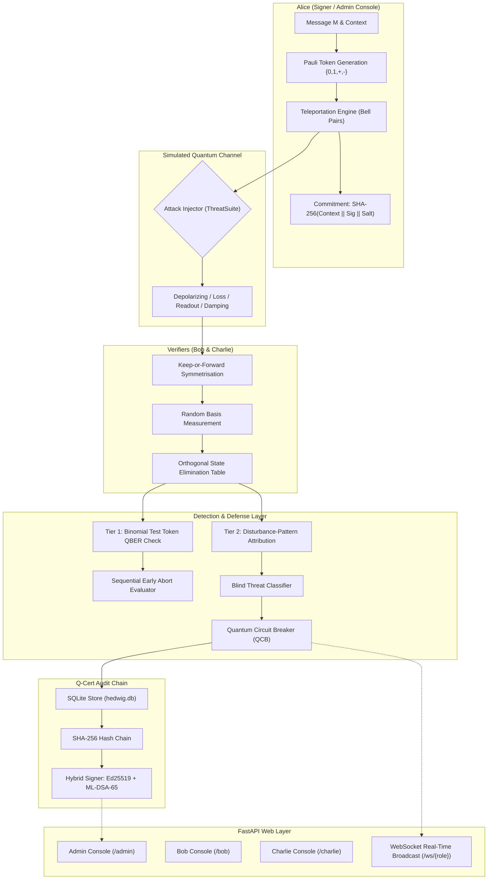

# HEDWIG — Teleportation-Based Quantum Digital Signatures with Cyber Threat Detection

[](https://www.python.org/)
[](https://fastapi.tiangolo.com/)
[](https://qiskit.org/)
[]()
[](LICENSE)

> **Beginner Guide Available:** If you are new to Quantum Digital Signatures or want an intuitive, plain-English breakdown with analogies and viva preparation, see [FOR_DUMMIES.md](FOR_DUMMIES.md).

---

## 🌟 1. Executive Summary & Problem Statement

### The Problem
Classical digital signatures (RSA, ECDSA) rely on computational hardness assumptions (integer factorisation, discrete logarithms) vulnerable to Shor's algorithm on large-scale quantum computers. While Post-Quantum Cryptography (PQC) algorithms (e.g. ML-DSA / Dilithium) introduce lattice-based hardness, they remain computational. 

**Quantum Digital Signatures (QDS)** provide information-theoretic non-repudiation and unforgeability rooted in quantum mechanics:
- **Heisenberg Uncertainty Principle:** Non-commuting observable bases cannot be simultaneously measured without disturbance.
- **No-Cloning Theorem:** Unknown quantum states cannot be copied identically.

However, classical-quantum networked QDS systems face realistic vulnerabilities:
1. Physical and hardware noise (depolarizing, amplitude damping, readout bias, photon loss) mimic malicious tampering.
2. Active quantum adversaries (intercept-resend, optimal quantum cloning, loss exploitation).
3. Protocol and verifier threats (dishonest verifier forgery, sender repudiation, packet replay, impersonation).
4. Cascading denial-of-service from false alarms if quantum links are indiscriminately cut.

### The Solution: HEDWIG V2.2
**HEDWIG** is an interactive, simulated three-party Quantum Digital Signature platform (Alice, Bob, Charlie) equipped with:
- **Simulated Quantum Teleportation:** Bell-state teleportation ($|\Phi^+\rangle$) of random Pauli-eigenstate tokens ($\{|0\rangle, |1\rangle, |+\rangle, |-\rangle\}$) over configurable noisy channels (Qiskit Aer / Statevector simulation).
- **Two-Tier Blind Statistical Threat Detection:** Evidence-driven discrimination of channel noise vs. quantum eavesdropping vs. message tampering without machine learning or prior attack labels.
- **Sequential Early Abort:** Block-by-block channel testing that halts quantum token transmission immediately when error thresholds are decisively crossed, saving quantum resources and link bandwidth.
- **Adaptive Quantum Circuit Breaker (QCB):** Multi-state per-link enforcement engine (`OPEN`, `WATCH`, `QUARANTINED`, `RESET_PENDING`) featuring sequential early abort and Fisher's combined p-value escalation.
- **Tamper-Evident Q-Cert Audit Ledger:** Immutable SHA-256 hash-chained audit ledger dual-signed with classical **Ed25519** and NIST FIPS 204 **ML-DSA-65 (Dilithium)**.

---

## 🏛️ 2. System Architecture & Component Interaction



### The 5-Phase Protocol Pipeline
1. **Token Generation & Symmetrisation:** Alice creates pairs of Pauli eigenstates for each bit position. Bob and Charlie exchange half their received tokens via random swap gates ("keep-or-forward") so Alice cannot know who holds which token.
2. **Teleportation & Elimination:** States are teleported over simulated Bell channels with feed-forward Pauli corrections. Receivers measure each token in a random basis ($\{Z, X\}$) to eliminate an orthogonal candidate from their verification table.
3. **Commitment Binding:** Alice broadcasts a SHA-256 commitment containing the message digest, recipient list, session nonce, expiration timestamp, and random blinding salt before any states are revealed.
4. **Channel Testing & Sequential Early Abort:** Interleaved secret test tokens evaluate link fidelity block-by-block. If error counts exceed the binomial threshold early, transmission aborts immediately to conserve quantum resources.
5. **Independent Verification & Response:** Bob and Charlie verify received signatures against their elimination tables. Mismatch counts are tested against Hoeffding and exact binomial acceptance thresholds ($s_a$ for direct delivery, $s_v$ for forwarded).

---

## 💻 3. Technology Stack

- **Core Runtime:** Python 3.11+
- **Quantum Simulation:** `qiskit` (2.5.2), `qiskit-aer` (0.17.2), `numpy` (2.3.2)
- **Backend API & Web Server:** `fastapi` (0.115.0), `uvicorn` (0.30.6), `websockets` (16.0), `jinja2` (3.1.6)
- **Classical & Post-Quantum Cryptography:** `cryptography` (48.0.0), `dilithium-py` (1.4.0, NIST FIPS 204 ML-DSA-65)
- **Persistence & Auditing:** SQLite 3 (`sqlite3` standard library), Ed25519 PEM keys, JSON-canonical hash chains
- **Testing & Quality Assurance:** `pytest` (24 automated test suites)
- **Experiments & Benchmarking:** Multiprocessing trial harnesses with seeded RNGs, Wilson score intervals, and ROC curves

---

## 📁 4. Repository Structure & Key Modules

```text
├── server.py                        # FastAPI application, route handlers, WebSocket hub
├── auth.py                          # PBKDF2-SHA256 authentication & role-based sessions
├── users.json                       # Hashed credentials for demo / operational users
├── requirements.txt                 # Core production dependencies
├── requirements-pq.txt              # Optional post-quantum ML-DSA-65 requirements
├── requirements-dev.txt             # Development and testing dependencies
├── run_v2.bat                       # One-click Windows launch script
├── run_experiments.py               # Reproducible experiment runner & manifest generator
├── templates/                       # Jinja2 HTML templates
│   ├── login.html                   # Multi-role login interface
│   ├── admin.html                   # Alice sender console, threat injector, circuit reset
│   ├── bob.html                     # Bob verifier terminal & dishonest forward trigger
│   └── charlie.html                 # Charlie verifier terminal & cross-check audit view
├── static/                          # Styling and client-side logic
│   ├── css/style.css                # Custom vanilla CSS design system
│   ├── js/app.js                    # WebSocket listeners, dynamic DOM updating, charts
│   └── img/icons.svg                # SVG icons and visual assets
├── src/quantum_engine/              # Core simulated quantum cryptography engine
│   ├── __init__.py                  # Public exports and package definition
│   ├── protocol.py                  # Orchestrator: TeleportationQDS main execution
│   ├── teleportation.py             # Qiskit Bell-state teleportation & basis state prep
│   ├── symmetrisation.py            # Keep-or-forward random token swapping
│   ├── elimination.py               # Orthogonal state measurement & elimination tables
│   ├── channel.py                   # Quantum channel models (depolarizing, readout, loss, damping)
│   ├── threats.py                   # 11 attack scenario injectors (ThreatSuite)
│   ├── detection.py                 # QDSDetectionEngine & ThreatReport classification
│   ├── discriminator.py             # Tier 2 disturbance-pattern attribution
│   ├── policy.py                    # ResponsePolicy & Fisher's combined p-value escalation
│   ├── enforcement.py               # ChannelGuard & Quantum Circuit Breaker (QCB)
│   ├── binding.py                   # SignedContext & cryptographic commitment validation
│   ├── verifier.py                  # VerifierNode & Hoeffding/exact threshold checks
│   ├── cloning.py                   # Quantum cloner models (universal & phase-covariant)
│   ├── audit.py                     # Q-Cert ledger, hash chains, and certificate generation
│   ├── signers.py                   # Ed25519 and ML-DSA-65 post-quantum signing logic
│   ├── store.py                     # SQLite persistence for sessions, transitions & audits
│   ├── router.py                    # Simulated quantum network routing and link state
│   ├── schedule.py                  # Measurement basis scheduling
│   ├── thresholds.py                # Exact binomial limits & reserve stage planning
│   └── security.py                  # Theoretical security parameters and bound models
├── tests/                           # 24 test suites covering protocol, noise, API & ablations
└── experiments/                     # Scientific evaluation harness, sweeps, ROC & ablation scripts
    ├── harness.py                   # Resumable grid harness (seed x scenario x L x noise)
    ├── make_roc.py                  # ROC curve generation with seeded bootstrap AUC intervals
    ├── ablate_early_abort.py        # Sequential early abort evaluation & bandwidth savings
    ├── ablate_tiers.py              # Tier 1 vs Tier 1+2 attribution ablation study
    ├── ablate_escalation.py         # Fisher combined p-value vs k-alert counter ablation
    ├── ablate_adaptive.py           # Fixed vs adaptive test token allocation
    ├── baselines.py                 # Benchmarking against 11% QBER cutoff & no-breaker baseline
    └── sweep_*.py                   # Physical sweeps (damping, readout, loss, tiers)
```

---

## ⚡ 5. Installation & Setup

### 5.1 Prerequisites
- **Operating System:** Windows, Linux, or macOS
- **Python:** 3.11 or higher installed and added to `PATH`

### 5.2 Step-by-Step Installation

1. **Clone the repository:**
   ```bash
   git clone <repository-url>
   cd "sih 2026"
   ```

2. **Create and activate a virtual environment:**
   - *Windows (PowerShell):*
     ```powershell
     python -m venv .venv
     .\.venv\Scripts\Activate.ps1
     ```
   - *Linux / macOS:*
     ```bash
     python3 -m venv .venv
     source .venv/bin/activate
     ```

3. **Install Dependencies:**
   - Core dependencies:
     ```bash
     pip install -r requirements.txt
     ```
   - Post-quantum ML-DSA-65 signatures (recommended):
     ```bash
     pip install -r requirements-pq.txt
     ```
   - Development & test dependencies:
     ```bash
     pip install -r requirements-dev.txt
     ```

4. **Run the Application:**
   ```bash
   python server.py
   ```
   Or on Windows:
   ```cmd
   run_v2.bat
   ```
   Open your browser to: **`http://localhost:8000`**

---

## 🔑 6. Authentication & Roles

HEDWIG isolates signer, verifier, and monitoring functions using role-based sessions stored in HttpOnly, SameSite=Strict cookies (`hedwig_admin`, `hedwig_bob`, `hedwig_charlie`).

| Username | Password | Role | Access Route | Functional Scope |
| :--- | :--- | :--- | :--- | :--- |
| `admin` / `alice` | `admin2026` / `quantum2026` | `admin` | `/admin` | State preparation, signing, threat injection, circuit breaker resets, full ground-truth audit |
| `bob` | `quantum2026` | `bob` | `/bob` | Verifier 1 inspection, elimination records, dishonest forward attack trigger |
| `charlie` | `quantum2026` | `charlie` | `/charlie` | Verifier 2 inspection, forwarded signature reception, cross-verification |

*To provision custom users:*
```bash
python auth.py add-user users.json newuser admin
```
Set the environment variable: `HEDWIG_USERS_FILE=users.json`.

---

## 🛡️ 7. Threat Catalog & Detection Mechanics

HEDWIG implements **11 simulated threat scenarios** executed via `src/quantum_engine/threats.py`:

| Threat Type | Mechanism | Detection Layer | Action |
| :--- | :--- | :--- | :--- |
| **`authentic`** | Honest transmission under typical depolarising channel noise ($p=0.01$). | $k \le \text{Threshold}$, Mismatches $\le \lfloor s_a n \rfloor$. | **ACCEPTED** (Link: `OPEN`) |
| **`eve_forgery`** | Adversary replaces Alice's revealed classical signature with random guesses. | Elimination mismatches ($\approx 25\%$) + commitment mismatch. | **EXTERNAL_FORGERY** (reject the package; quantum routes remain available) |
| **`eve_intercept`** | Eve intercept-resends Bell qubits during teleportation. | Disclosed test tokens show elevated QBER ($\approx 25\%$). Early abort triggered. | **EAVESDROPPING_TAMPERING** (`QUARANTINE`) |
| **`message_tampering`**| Classical message content modified in transit after signing. | Recomputed message digest $\neq$ committed context digest. | **MESSAGE_INTEGRITY_VIOLATION** (Reject; Link remains `OPEN`) |
| **`repudiation`** | Dishonest Alice sends orthogonal states to Charlie to deny her signature. | Commitment holds, but signature contradicts distributed elimination states. | **REPUDIATION_ATTEMPT** (`QUARANTINE` / `WATCH`) |
| **`replay`** | Adversary re-sends a previously accepted signature payload. | Session nonce found in consumed nonce replay registry. | **REPLAY_ATTACK** (Reject; Link remains `OPEN`) |
| **`impersonation`** | Rogue party attempts verification without a valid distribution record. | Missing session distribution mapping in verifier memory. | **IMPERSONATION_ATTACK** (Reject; Link remains `OPEN`) |
| **`dishonest_bob`** | Bob tampers with a signature and forwards it to Charlie. | Fails Charlie's forwarded threshold $s_v$ and commitment validation. | **DISHONEST_VERIFIER_FORGERY** (Quarantine `bob->charlie`) |
| **`eve_loss_exploit`** | Eve intercepts and drops quantum tokens, then may substitute the revealed classical signature. | Channel tests and surviving evidence decide channel disturbance/loss. Classical signature substitution is checked separately. | Channel disturbance can restrict its path; `EXTERNAL_FORGERY` alone rejects only the package. |

> **Fair-Sampling Assumption in QDS with Erasure:**
> In lossy quantum channels, heralded token loss (erasure) is treated as benign physical attenuation rather than an active attack, provided the channel satisfies the *fair-sampling assumption* (loss occurs independently of token state or measurement basis). An adversary exploiting loss (`eve_loss_exploit`) attempts to bypass detection by discarding poorly-measured tokens. HEDWIG prevents this vulnerability by enforcing a minimum surviving token count $n_{\min}$ (e.g., $\ge 60\%$ of planned tokens); if surviving tokens drop below $n_{\min}$, the session aborts with `INSUFFICIENT_TOKENS` and places the link on `WATCH` rather than accepting compromised subsets.
| `authentic` | Normal transmission over noisy channel | Acceptance | `OPEN` |
| `eve_forgery` | Eve manufactures random tokens without Alice's keys | Elimination Table (~25% contradictions) | `QUARANTINED` |
| `dishonest_bob` | Bob alters signature bits and forwards to Charlie | Forward Elimination Check ($s_v$ threshold) | `QUARANTINED` |
| `eve_intercept` | Intercept-resend measuring in random Pauli bases | Tier 1 Channel Test QBER (Eavesdropping) | `QUARANTINED` |
| `message_tampering`| Eve modifies plaintext $M \to M'$ in flight | Classical Commitment & SHA-256 Digest Mismatch | Link stays `OPEN` (Prevents DoS) |
| `repudiation` | Alice signs, but selectively flips revealed tokens | Tier 2 Attribution (Disturbance vs Signature mismatch) | `QUARANTINED` |
| `replay` | Replaying previously captured valid transmission | Context Nonce & Timestamp Verification | Link stays `OPEN` (Prevents DoS) |
| `impersonation` | Claiming Alice's identity without valid distribution | Sender Identity & Distribution Record Check | Link stays `OPEN` (Prevents DoS) |
| `eve_loss_exploit` | Eve blocks disturbed tokens simulating photon loss | Readout / Channel Loss Anomaly Detector | `WATCH` / `QUARANTINED` |
| `eve_cloning` | Eve uses optimal quantum cloner (Universal / Phase) | Cloner fidelity bound violation | `QUARANTINED` |
| `eve_partial_intercept`| Eve intercepts only a fraction of tokens ($5\%$) | Sequential Early Abort / Fisher's Escalation | `WATCH` $\to$ `QUARANTINED` |
| `eve_collective` | Eve couples an ancilla to every token with the same controlled-Ry($\theta$) and measures the ancillas after basis announcement. **One concrete collective attack, not a proof against collective attacks in general.** | Dephasing of X-basis tokens raises test-token QBER (Tier 1). At $\theta=\pi/2$: Eve guesses 67.7% of bits, verifier mismatch 3.8%, detected in 59-65% of transmissions (`experiments/sweep_collective.py`) | `WATCH` / `QUARANTINED` when detected |

### 6.1 Optional N-verifier extension (recipient scaling)

One signer (Alice) can serve a fixed group of **2 to 10 pre-enrolled verifiers**. The default is unchanged: Alice with Bob and Charlie, direct delivery, one re-forward hop. The extension lets more recipients independently authenticate the same signed message, including through a bounded forwarding chain. Example: headquarters issues an instruction and each regional office checks it before acting. It is an optional add-on; the project's focus remains threat detection.

| Setting | Values | Notes |
| :--- | :--- | :--- |
| Roster (N) | 2–10 enrolled identities (`bob, charlie, dave, erin, frank, grace, heidi, ivan, judy, kim`) | Fixed before distribution and bound into the signer's commitment (`SignedContext.verifiers`) |
| Delivery | `direct` (Alice reveals to everyone) or `chain` (Alice reveals to the first member; each member that accepts forwards the unchanged package to the next) | Forwarding is classical package transfer, not new quantum evidence |
| Max depth (H) | `direct`: 1. `chain`: 1 … N − 1 | Members beyond depth H are reported as `outside_depth` |

**Behaviour**

- **Distribution.** Alice prepares one copy of each signature position per roster member. With N > 2, each copy is reassigned privately to a holder chosen uniformly at random (*uniform final holder*). For N = 2 the original keep-or-forward rule is kept; it has the same holder probabilities. Every member receives its evidence before the reveal; nothing is created after the reveal.
- **Depth-aware decisions (exact policy).** Depth 0 uses the direct limit k_fr and depth H the forwarded limit k_fa. Levels in between are evenly spaced whole numbers in [k_fr, k_fa] that never decrease with depth, so every level meets both risk targets whenever the endpoints do. With H = 1 the rules are exactly the original direct/forwarded pair. When there is too little evidence to support distinct limits, levels share a limit (see the table below); no thresholds are invented. The legacy schedule s_l = μ_h + (l+1)(p_min − μ_h)/(H+2) is available only under `threshold_policy="legacy"` and is labelled experimental.
- **Transfer integrity.** Each recipient works out the applicable depth from its own distribution record and the authenticated sender, never from the package. An unknown forwarder, an edge not on the route, a wrong claimed depth, or a missing or substituted parent event makes the transfer invalid. An invalid transfer is evaluated under the strictest (depth 0) rule and rejected as `INVALID_TRANSFER`, a classical rejection that does not lock the link.
- **Duplicates and the reserve.** Each verifier evaluates at most one forwarded delivery per session, from any sender or route. The reserve is opened at most `max_reserve_openings` times per session across all channels. If Alice cannot open it, the result stays inconclusive.
- **Stop rule.** Normal forwarding stops at a rejection or an inconclusive result. Recipients after that point are `not_reached`, which is not the same as rejected.
- **Session outcome.** `all_accepted` only if every required recipient accepted (there is no majority rule). Otherwise `rejected`, `inconclusive`, `incomplete` or `distribution_aborted`.

**Additional scenarios.** In each, one selected verifier is dishonest; collusion is not modelled.

| Scenario | Mechanism | Observed result |
| :--- | :--- | :--- |
| `dishonest_forwarder` | Receives the genuine package, then alters the message or signature and forwards it | The next honest recipient rejects: digest mismatch (message) or commitment mismatch (signature). Classified as `DISHONEST_VERIFIER_FORGERY` |
| `forward_withheld` (chain) | Accepts but never forwards | Downstream members are `not_reached`; session `incomplete`; no forgery alleged |
| `route_manipulation` (chain) | Forwards the genuine package claiming a deeper level | Refused at depth 0 → `INVALID_TRANSFER` |
| `forward_replay` | The same package reaches a recipient again (from another sender in direct mode) | Refused as a duplicate without opening the reserve → `REPLAY_ATTACK` |
| `unknown_forwarder` | An identity that is not enrolled forwards the genuine package | `INVALID_TRANSFER` |

**Records.** Every verification is a ledger event with a unique id, its session, its sender, its depth and its parent event. Events are persisted in SQLite (`sessions` and `verification_events` tables) and are never keyed by verifier + mode, so repeated events do not overwrite each other. New audit records use `hedwig-audit/3`:
- The transaction record binds the roster, delivery mode, H and the reveal events.
- Each chain forwarding event is its own immutable `transfer` record, naming its parent event and the artifact id and payload hash of the record that holds it.
- `hedwig-audit/2` certificates still verify under their original rules.

The one-time quantum evidence is still not persisted, so after a restart a pending session must be redistributed.

**Interface.** Admin console → *Recipient group*: N, delivery, H, dishonest forwarder and alteration. A *Recipient matrix* shows one row per participant with its durable event history (`GET /api/sessions/{id}/events`). The Bob and Charlie terminals are unchanged. They never see extra recipients, the other verifier's private evidence, or symmetrisation decisions.

**Limitations (stated, not solved)**

- Adding recipients does **not** add security. It is not universal (public) verification, and it is not group approval, multiple signers or threshold signing.
- Security against collusion between recipients is not claimed. Per-event risks are reported; **no session-level aggregate bound** is claimed, because all recipients' evidence comes from one distribution and is not independent.
- A rejection does not by itself show which participant caused it.
- The transfer margin only appears with enough evidence. With about L checked copies per verifier, the depth limits stay equal up to L ≈ 64 and separate around L ≈ 128. The dashboard caps L at 64, so in the UI all depths currently show the same limit.
- Isolation acts on the two logical links: signer distribution, and verifier transfers pooled together. Per-edge hop counters show traffic but are not used to attribute blame to an edge.
- Distribution cost grows linearly with N (one copy per recipient per position). See `experiments/n_verifier_eval.md`.
- Published multiparty QDS work (e.g. arXiv:1505.07509) is a reference for this analysis, not a proof that applies to this codebase.

---

## ⚙️ 8. Configuration & Environment Variables

| Variable | Default | Options | Description |
| :--- | :--- | :--- | :--- |
| `PORT` | `8000` | Integer | HTTP web server port |
| `HOST` | `0.0.0.0` | IP string | Bind host address |
| `HEDWIG_BACKEND` | `qiskit` | `qiskit`, `statevector` | Quantum simulation engine |
| `HEDWIG_DB` | `data/hedwig.db` | Path | SQLite persistent database path |
| `HEDWIG_AUDIT_KEY` | `data/audit_ed25519.pem` | Path | Ed25519 audit authority private key path |
| `HEDWIG_AUDIT_PQ` | `auto` | `auto`, `require`, `off` | Enforce ML-DSA-65 post-quantum dual signing |
| `HEDWIG_USERS_FILE` | None | Path to JSON | PBKDF2 hashed credentials file path |
| `EARLY_ABORT` | `on` | `on`, `off`, `true`, `false` | Enable/disable sequential early abort |
| `DETECTION_TIERS` | `2` | `1`, `2` | Detection tier depth (ablation toggle) |

---

## 📡 9. REST API & WebSocket Endpoints

| Endpoint | Method | Role | Description |
| :--- | :--- | :--- | :--- |
| `/api/login` | `POST` | Public | Authenticates credentials and sets role session cookie |
| `/api/logout` | `POST` | Public | Revokes session token and deletes cookie |
| `/api/sign-and-send` | `POST` | `admin` | Executes token prep, teleportation, commitment, and verification |
| `/api/dishonest-bob-forward` | `POST` | `bob` | Triggers dishonest Bob forwarding attack to Charlie |
| `/api/channel/reset` | `POST` | `admin` | Resets quarantined link to probation (Requires reason) |
| `/api/channel` | `GET` | Any | Returns current Quantum Circuit Breaker status |
| `/api/topology` | `GET` | Any | Returns simulated quantum router and network topology |
| `/api/history` | `GET` | Any | Returns recent transmission records (scrubbed of ground-truth) |
| `/api/audit/{artifact_id}` | `GET` | Any | Downloads signed Q-Cert certificate JSON |
| `/api/audit/chain` | `GET` | `admin` | Retrieves entire SHA-256 hash chain and validation report |
| `/api/audit-public-key` | `GET` | Public | Keyring endpoint with active and retired public keys |
| `/api/audit/verify` | `POST` | Public | Independent verification of supplied Q-Cert certificate |
| `/api/metrics` | `GET` | `admin` | Telemetry, latency statistics, and error counters |
| `/results` | `GET` | Any | Experiment results page (ROC, ablations, baselines, tightness, hardware, manifest) read from `experiments/results/` |
| `/ws/{role}` | `WebSocket` | Role-Specific | Full-duplex WebSocket stream for real-time console updates |

---

## 🧪 10. Automated Testing & Verification

The repository contains an extensive automated test suite executed with `pytest`:

```bash
# Run all tests
pytest -v

# Run fast execution without verbose logging
pytest -q
```

---

## 10. Step-by-Step Demo Script for Judges

To showcase the system during Hackathon presentations, follow this recommended walkthrough (use token length **$L = 32$ or $64$**):

1. **Honest Signature Demonstration:**
   - On `/admin`, select $L = 32$, keep threat as `authentic`, and click **Sign & Teleport Signature**.
   - Switch to `/bob`: show green **VERIFIED** badge, 0 elimination mismatches, and binomial channel confidence.
   - Click **Download Audit Certificate (Q-Cert)** and run `tools/verify_audit.py` in terminal to prove cryptographic authenticity.
2. **Message Tampering Detection:**
   - On `/admin`, select `message_tampering` and enter modified text.
   - Show on `/bob` that the message digest mismatch is flagged instantly while quantum links remain `OPEN` (preventing denial-of-service lockout).
3. **Classical Forgery Rejection:**
   - On `/admin`, arm `eve_forgery` and submit.
   - Show elimination contradictions and commitment failure. `EXTERNAL_FORGERY` rejects the forged package; an authentic next send remains possible. This supplies no evidence that a quantum edge failed.
4. **Eavesdropping Intercept & Early Abort:**
   - For link-local failover, activate the multi-hop demo, send a baseline, inject and probe an intercept on `R1->R2`, then send fresh qubits. Keep that edge quarantined: the next route goes through R3 without resetting it.
   - The top-of-page **Run isolated failover test** performs this sequence in a separate test network and shows actual traversal counts and zero resets. **Last send / Next send** explains the active network's route choice.
   - The older `eve_intercept` card injects a session-wide attack on whichever route is chosen. Repeating that attack can affect both routes; it is not a single-edge fault.
5. **Post-Quantum Audit Chain Verification:**
   - In the Admin console, click **Verify Audit Chain**.
   - Show that all transaction records, incidents, and administrative resets form a continuous, untampered SHA-256 hash chain with dual Ed25519 and ML-DSA-65 signatures.

---

## 11. Configuration & Environment Variables

| Variable | Default Value | Options | Description |
| :--- | :--- | :--- | :--- |
| `PORT` | `8000` | Integer | Application HTTP port |
| `HEDWIG_BACKEND` | `qiskit` | `qiskit`, `statevector`, `ibm_fake` | Quantum simulation engine backend |
| `HEDWIG_NOISE_PROFILE` | `depolarizing` | `depolarizing`, `ibm_fake` | Channel noise model profile |
| `HEDWIG_IBM_FAKE_BACKEND` | *(auto)* | Fake backend name (e.g. `FakeManila`, `FakeSherbrooke`, `GenericBackendV2`) | Target IBM fake backend provider |
| `HEDWIG_IBM_MODE` | `calibrated` | `calibrated`, `full` | Mode for IBM noise simulation (`full` per-token Aer circuit vs fast pre-calibrated matrix) |
| `HEDWIG_USERS_FILE` | *(None)* | Path to JSON | Path to PBKDF2 hashed credentials file |
| `HEDWIG_DB` | `data/hedwig.db`| Path to SQLite DB | Persistent database file path |
| `HEDWIG_AUDIT_KEY` | `data/audit_ed25519.pem`| Path to PEM | Master audit signing key location |
| `HEDWIG_AUDIT_PQ` | `auto` | `auto`, `off`, `require`| Post-quantum ML-DSA-65 signature policy |

### 11.1 IBM Fake-Backend Realistic Noise Model

HEDWIG supports realistic quantum computer noise profiles using IBM backend calibration data:
- **Noise Profile (`ibm_fake`):** Builds a noise model via `NoiseModel.from_backend()` using `qiskit_ibm_runtime.fake_provider` (or built-in `GenericBackendV2`). Configurable via `HEDWIG_IBM_FAKE_BACKEND`.
- **Deferred-Measurement Teleportation:** Teleportation circuits use coherent controlled gates ($CX$ and $CZ$) rather than mid-circuit feed-forward measurements, ensuring transpilation compatibility with real hardware basis gates.
- **Simulation Modes:**
  - `FULL`: Runs transpiled Aer circuits with IBM noise per token (ideal for demos and $L \le 200$).
  - `CALIBRATED`: Pre-characterizes the backend (~5,000 shots across basis states), persists empirical transition rates to `experiments/calibration/ibm_<backend>.json`, and executes fast token evaluations.
- **Metadata & Q-Cert Audit:** Backend name, calibration timestamp, and effective error rates are automatically stored in transmission metadata and certified within the Q-Cert audit record.

---

## 12. REST API & WebSocket Reference

| Method & Endpoint | Auth Role | Description |
| :--- | :--- | :--- |
| `POST /api/login` | Public | Authenticates user and sets role-scoped session cookie |
| `POST /api/logout` | Public | Invalidates active user session |
| `POST /api/sign-and-send` | Admin | Initiates QDS generation, teleportation, and verification. Optional: `n_verifiers` / `roster`, `delivery`, `max_depth`, `dishonest_verifier`, `forward_alteration` (§6.1); unsupported combinations → HTTP 400 |
| `GET /api/roster` | Admin | Enrolled identities and limits of the N-verifier extension |
| `GET /api/sessions/{id}/events` | Admin | Durable roster and verification-event history of one session |
| `POST /api/arm-threat` | Admin | Configures active threat injection scenario |
| `POST /api/dishonest-bob-forward` | Bob | Triggers forged forwarded signature transmission to Charlie |
| `POST /api/channel/reset` | Admin | Resets quarantined link to probation (Requires mandatory reason) |
| `GET /api/topology` | Any | Returns real-time quantum router and link state graph |
| `GET /api/history` | Any | Fetches historical transmissions (Hides ground-truth attack labels) |
| `GET /api/verification/{tx}/{verifier}`| Verifier | Retrieves verifier-specific measurement and elimination records |
| `GET /api/audit/{id}` | Any | Retrieves signed Q-Cert audit certificate |
| `GET /api/audit/chain` | Admin | Exports full cryptographic audit chain with validity check |
| `GET /api/audit-public-key` | Public | Keyring endpoint with active and retired public keys |
| `POST /api/audit/verify` | Public | Server-side offline certificate verification endpoint |
| `GET /api/metrics` | Admin | Performance, latency breakdown (p50/p95/p99), and throughput |
| `GET /api/security-events` | Admin | Security audit log (failed logins, forbidden queries) |
| `WS /ws/{role}` | Role-Specific | Full-duplex WebSocket stream for real-time UI updates |
**Key Test Coverage:**
- `test_teleportation.py`: Bell-pair teleportation fidelity and feed-forward Pauli operations.
- `test_cloning.py`: Universal and phase-covariant cloner fidelity bounds.
- `test_detector_blind.py`: Blind threat detection without ground-truth labels.
- `test_enforcement_audit.py`: Circuit breaker state machine and Q-Cert hash chain.
- `test_noise_readout.py`, `test_loss.py`, `test_noise_damping.py`: Quantum channel noise models.
- `test_partial_intercept.py`: Opt-in partial intercept-resend attack dynamics.
- `test_ablations.py`: Toggles and metrics for sequential early abort and 1-tier vs 2-tier detection.
- `test_harness.py`: Resumable grid experiment runner and RNG determinism.
- `test_make_roc.py`: Verifier mismatch ROC generation and AUC interval estimation.
- `test_api.py`: FastAPI endpoints, cookie validation, and role enforcement.

---

## 🔬 11. Scientific Reproducibility & Experiments

Every experiment result, table, and ROC curve can be reproduced with a single command:

```bash
python run_experiments.py --seed 2026            # full run, tens of minutes
python run_experiments.py --quick                # smoke test: every step at tiny trial counts (~10 s)
python run_experiments.py --seed 2026 --resume   # skip steps already finished with identical settings
```

Outputs are saved under `experiments/results/`:
- `raw.jsonl`: Raw per-trial execution records.
- `summary.csv`: Aggregated detection and false-alarm rates with 95% Wilson confidence intervals.
- `manifest.json`: System provenance, git commit, packages, seed, and per-step execution timing.
- `PPT_NUMBERS.md`: Verified numerical claims mapped to their origin data files.

---

## ⚠️ 12. Limitations & Simulation Scope

In strict adherence to academic and engineering integrity:
1. **Simulation Platform:** This software is a **classical numerical and circuit simulation** using Qiskit Aer and NumPy statevectors. It executes on classical CPUs and **does not provide physical quantum hardware security**.
2. **Channel Assumptions:** Quantum channels, fiber loss, and detector clicks are modeled using statistical noise models (depolarizing, amplitude damping, asymmetric readout error).
3. **Post-Quantum Reference Implementation:** `dilithium-py` provides a pure-Python reference implementation of ML-DSA-65 suitable for demonstration; it is not side-channel hardened for production environments.
4. **Computational Binding:** The commitment scheme relies on the computational preimage and collision resistance of SHA-256.

---

## 👥 13. Team & Attribution

- **QDS (Quantum Digital Signatures):** Signatures offering theoretical unforgeability based on the fundamental laws of quantum physics rather than computational hardness *(note: this repository simulates the protocol via classical statevector and circuit emulation, so it does not provide physical quantum-channel security)*.
- **Bell Pair ($|\Phi^+\rangle$):** Maximally entangled two-qubit quantum state used as a resource channel for quantum teleportation.
- **Quantum Teleportation:** Technique to transfer an unknown quantum state using a shared Bell pair and classical transmission.
- **Symmetrisation:** Random swapping of quantum copies between verifiers to prevent the signer from treating verifiers unequally.
- **Elimination Table:** Verifier record of orthogonal states ruled out by quantum measurements.
- **QCB (Quantum Circuit Breaker):** Automated multi-state security mechanism enforcing adaptive testing, link quarantine, and controlled probation.
- **ML-DSA-65:** NIST FIPS 204 standard Module-Lattice-Based Post-Quantum Digital Signature Algorithm (Dilithium).

## Multi-hop routing

The admin console now supports a JSON topology, hop-by-hop teleportation, independent edge probes, and fresh-session rerouting around WATCH or QUARANTINED links. Activate **Multi-hop demo (R1/R2 + R3)** under **Links & router → Quantum routes** to try the middle-link attack and alternate path. The legacy star remains the default.

See [the implementation and demonstration guide](MULTI_HOP_ROUTING_IMPLEMENTATION.md) for policies, APIs, assumptions, historical graph/table/matrix views, and evaluation commands.
Developed by **Team ATHENA** for SIH 2026.  
For complete beginner guidance, analogies, and viva preparation, read [FOR_DUMMIES.md](FOR_DUMMIES.md).
